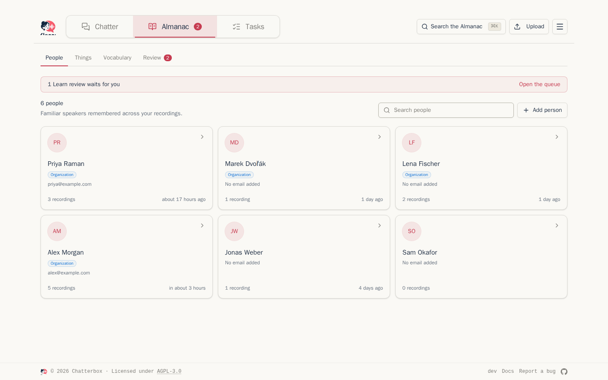
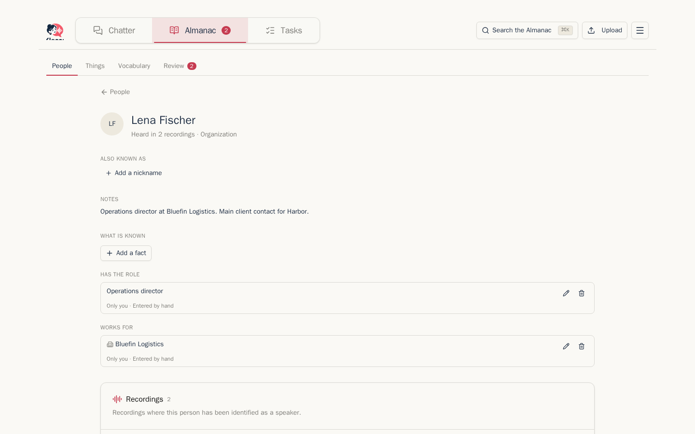
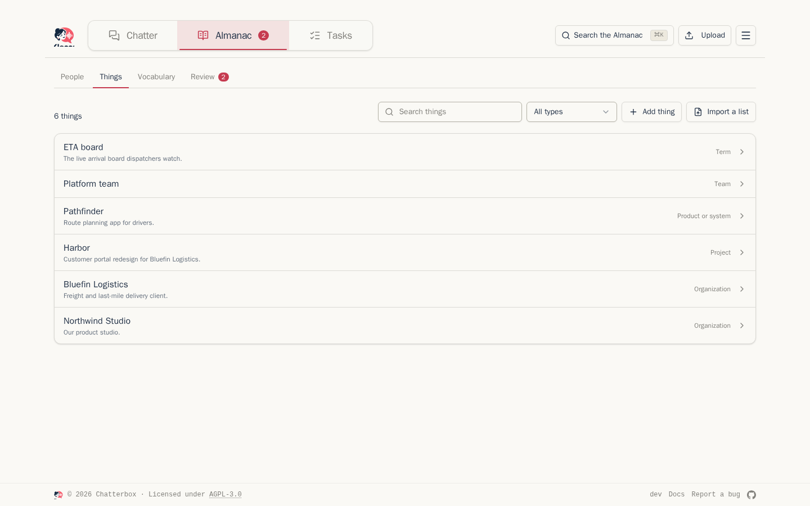
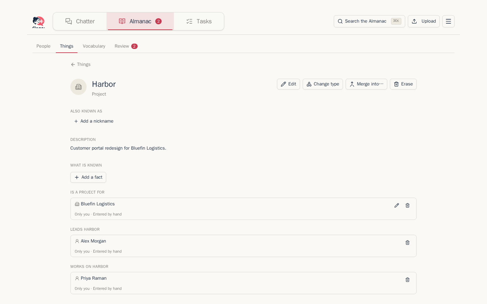
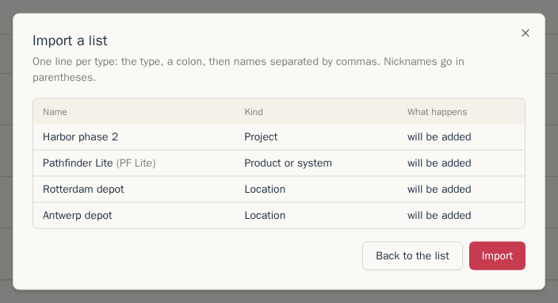
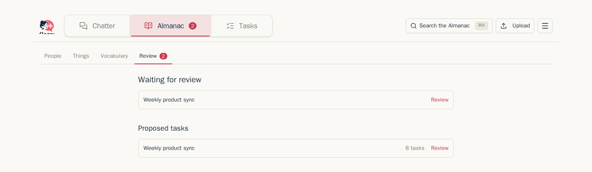

Almanach obsahuje vše, co Klepna ví o lidech a věcech, o kterých Vaše nahrávky hovoří: kdo je kdo, na čem kdo pracuje, jak se jmenuje projekt a jak bývá často špatně rozuměn. Přepis, Učení, souhrny a úkoly z něj vycházejí.

Obsahuje karty **Lidé**, **Věci**, **Slovník** a **Kontrola**. Kurátoři Organizace navíc vidí kartu **Péče**.

<span id="people" />

## Lidé



Každý, koho jste pojmenovali jako řečníka, je zde, včetně počtu nahrávek, ve kterých je slyšet. **Přidat osobu** umožní přidat někoho ještě před tím, než promluví. Dokud je formulář otevřený, spouštěcí tlačítko je neaktivní; použijte **Přidat osobu** nebo **Zrušit** uvnitř formuláře. Lidé označení jako **Organizace** pocházejí z nahrávek sdílených s Organizací (viz [Organizace](organization.md)).

Kliknutím na osobu otevřete její stránku:



- **Také známý jako**: přezdívky a jiné varianty jmen. Dokud je editor **Přidat přezdívku** otevřený, spouštěcí tlačítko je neaktivní; použijte **Přidat** nebo **Zrušit** ve formuláři. Vyhledávání podle nich osobu najde a Učení je rozpoznává v přepisech.
- **Poznámky**: cokoli si chcete zapamatovat. U organizačních osob jsou poznámky Vaše vlastní.
- **Co je známo**: fakta jako *pracuje pro Bluefin Logistics* nebo *má roli provozního ředitele*. **Přidat faktum** umožní zvolit vztah a druhou stranu z Almanachu, nebo použít prostý text. Klepna odmítá fakta o zdraví, rodině, osobnosti, výkonnosti nebo demografii.
- **Nahrávky**: kde tato osoba mluví.
- **To jsem já** určuje aplikaci Klepna, která osoba jste Vy. Učení pak ví, kdo nahrávku vytvořil, a Vaše úkoly se zobrazují pod záložkou **Moje**.
- **Přejmenovat**, **Sloučit do…** (pokud dvě položky představují tutéž osobu) a **Smazat**.

<span id="things" />

## Věci



Almanach používá základní typy **Osoba**, **Organizace**, **Tým**, **Projekt**, **Produkt nebo systém**, **Pojem**, **Místo** a **Dokument**. Věci můžete vyhledat, filtrovat podle typu, nebo kliknout na **Přidat věc**. Dokud je formulář otevřený, spouštěcí tlačítko je neaktivní; použijte **Přidat věc** nebo **Zrušit** uvnitř formuláře.



Stránka věci má stejné části jako stránka osoby: přezdívky, popis, fakta a nahrávky, s možnostmi **Upravit**, **Změnit typ**, **Sloučit do…** a **Smazat**.

<span id="importing-a-list" />

### Import seznamu

Volba **Importovat seznam** na kartě Věci umožňuje přidat více názvů najednou. Napište každý typ na samostatný řádek: typ, dvojtečka a názvy oddělené čárkou, přičemž přezdívky uveďte v závorkách:

```
project: Harbor phase 2
product: Pathfinder Lite (PF Lite)
location: Rotterdam depot, Antwerp depot
```

V seznamu pro import zůstávají anglické klíče `project`, `product` a `location`. V náhledu se jejich typy zobrazí jako **Projekt**, **Produkt nebo systém** a **Místo**.

Kliknutím na **Náhled** se zobrazí, co bude přidáno, než cokoliv uložíte:



<span id="vocabulary" />

## Slovník

**Slovník** zobrazuje druhy věcí a vztahů, které jste vytvořili nad rámec základních. Zde je můžete spravovat—ponechat, přejmenovat, sloučit nebo smazat. V Organizaci zde účet organizace rozhoduje o vztazích, které navrhli členové.

<span id="review" />

## Kontrola



**Kontrola** shromažďuje kontroly položek čekající na Vaše posouzení: běhy [Učení](learn.md) a navržené úkoly z nahrávky nebo pošty. Odznak na **Almanachu** tyto kontroly položek počítá. Změny úkolů předané Vám proto, že je můžete použít pouze Vy, čekají pod **Úkoly → Návrhy pro vás** a mají vlastní odznak v navigaci. Viz [Směrované návrhy](summaries-and-tasks.md#routed-proposals).

<span id="care-possible-duplicates" />

## Péče: možné duplicity

Kurátoři Organizace najdou pod **Almanach → Péče → Možné duplicity** osoby a věci, které mohou být zapsané dvakrát. Fronta obsahuje pouze záznamy Organizace. U dvojice je vysoká, střední nebo nízká shoda a její důvody: podobná jména, přezdívky, české tvary příjmení, přeslechy nebo právní forma firmy. Důvody proti shodě jsou jantarové, například oba potvrzení mluvčí v jednom přepisu nebo různé e-maily na různých doménách. Chybějící e-mail je pouze informace, nikoli problém k nápravě.

**Sloučit…** otevře oba záznamy vedle sebe. Klepna navrhne ponechat záznam s hlavním e-mailem, poté ten s více doklady. Můžete vybrat jiný, zvolit jméno a u rozporných jednohodnotových faktů určit, která hodnota zůstane aktuální. E-maily, přezdívky, přeslechy a fakta obou záznamů se zachovají; druhé jméno se uloží jako přezdívka. Nahrazené hodnoty faktů zůstanou v historii s doklady. Mluvčí, úkoly a odkazy přejdou na ponechaný záznam, druhý na něj bude přesměrovávat. U věcí různých typů zůstane typ ponechaného záznamu; fakta, která by mu neodpovídala, je třeba nejprve opravit.

**Nejsou stejní** uloží rozhodnutí pro danou dvojici v Organizaci, takže se už nenabídne ani jinému kurátorovi. **Později** ji skryje jen pro relaci této karty prohlížeče. Výběr cíle sloučení na stránce osoby nebo věci také řadí pravděpodobné shody na začátek.

Hledání kontroluje 2 000 nejnovějších živých záznamů každého druhu a jejich nejbližší shody. Duplicity se starším záznamem mimo tento limit se nenabízejí, ani když je druhý záznam nový. Procházení ani odmítání dvojic neposune hledání za tento limit. Omezené hledání označuje upozornění. Porovnání ukazuje sdílené položky a otevřené úkoly, soukromé položky kolegů zůstávají soukromé.

<span id="care-sharing-and-other-problems" />

## Péče: sdílení a další problémy

Odznak **Péče** počítá otevřené dvojice duplicit, nezkontrolované skupiny sdílení a ostatní otevřené problémy. Hledání se ukládá až na pět minut a ověřuje podle změn Almanachu Organizace. Ostatní problémy hledá nejvýše mezi 2 000 nejnovějšími záznamy každého druhu, 32 000 aktuálními fakty a 16 000 přeslechnutými podobami. Problémy mimo tyto limity se nemusí zobrazit. Hledání slabých záznamů ověřuje omezený vzorek a vynechá záznamy s více než 64 použitími.

- **Nové ze sdílení** seskupuje přírůstky za posledních 14 dní podle položky, sdílejícího a času. Ukazuje pouze aktuální pohled Organizace; soukromý název položky po zrušení sdílení zůstane skrytý. **Prohlédnout záznam** otevře záznam přírůstku, **Označit jako zkontrolované** odebere skupinu z odznaku. **Smazat přírůstek** a **Vrátit vše ze sdílení** odstraní nedotčené přírůstky. Položka zůstane sdílená. Upravené nebo sloučené záznamy, pozdější potvrzení, použití dalším sdílením a návazné znalosti z jiných zdrojů se zachovají s vysvětlením. Opakování vrácení dá stejný výsledek. Sdílení před touto aktualizací nemají záznam původu.
- **Rozporná fakta** najdou dvě aktuální hodnoty vztahu, který připouští jednu. U správné hodnoty zvolte **Ponechat**. Ostatní přejdou do historie i s doklady. **Zamítnout** uloží rozhodnutí pro tento konkrétní problém v Organizaci.
- **Opravy dvěma směry** najdou přeslechnutou podobu odkazující na různé záznamy Organizace. Ponechte správný cíl, čímž odstraníte opravy vedoucí k ostatním, nebo problém zamítněte.
- **Slabé záznamy** mají přesně jednu zmínku v položce, žádná fakta v obou směrech a nebyly 120 dní použity ani upraveny. **Smazat** ponechá záznam, pokud by smazání zasáhlo soukromé znalosti nebo jiný zdroj. Záznamy se soukromými návaznostmi, přiřazenými úkoly nebo historií sloučení se nenabízejí; **Ponechat** problém zamítne. Chybějící e-mail nikdy není druhem problému.

Zamítnutý problém se vrátí při změně podkladových dat. Archiv Organizace obsahuje rozhodnutí kurátorů v `knowledge/care-decisions.json`; importér je obnoví po záznamech, faktech a použití podle obsahu s přemapováním ID. Záznamy původu sdílení ani historie jejich vrácení se nearchivují. Po obnově znalosti zůstanou, ale stará sdílení už nelze vrátit přes Péči.

Požadavek na obnovu přes `/api/knowledge/care/restore` přijímá nejvýše 32 MiB JSON v UTF-8 včetně `archive` a `idMap`. Větší archiv rozdělte na podmnožiny polí `duplicates` a `problems`, každou zabalte jako archiv verze 1 s `provenance: "not-included"` a posílejte je postupně. Přiložte pouze přemapování ID potřebná pro danou část. Jedno rozhodnutí na limitech schématu se do limitu vejde. Každý požadavek se uloží samostatně; opakování je idempotentní a počty v odpovědi platí pro daný požadavek. Odpověď 413 nic neuloží: danou část rozdělte a zkuste znovu.

<span id="folder-knowledge" />

## Znalosti složky

Na hlavní stránce otevřete složku a v řádku ikon pod jejím názvem zvolte **Znalosti** (knihu); dalším kliknutím se vrátíte k položce. Znalosti vlastní složky nebo složky Organizace může číst každý, kdo složku vidí. Zahrnují položky složky a všech jejích podsložek, bez nadřazených složek. Lidé pocházejí z potvrzených mluvčích, oprav a dokladů faktů; věci z oprav a dokladů. Opravy ukazují přeslechnuté podoby použité v těchto položkách a počty použití. Fakta ukazují podpořené doklady s položkou a datem včetně pošty.

Kurátoři navíc u záznamů Organizace, oprav a faktů vidí označení otevřených problémů. Rozbalením lze přímo ve složce použít stejné opravy jako v Péči. Ostatní čtenáři mají nadále pohled pouze pro čtení.

Karta **Co dostanou modely** používá stejné funkce jako zpracování položek:

- **Přepis:** nejvýše 500 jmen, přezdívek a pojmů. První je nahrávající, pak použití ve složce, vlastní použití, přeslechy a pořadí jmen. Náhled vysvětluje pořadí, ukazuje první výrazy, počet vynechaných, hranici 500 a několik výrazů pod ní. Složky mění pořadí, nikdy nefiltrují dostupné záznamy Almanachu.
- **Oprava přepisu:** nejvýše 500 záznamů se jmény, přezdívkami a přeslechy, bez faktů. První jsou záznamy už zmíněné v přepisu, pak rozhoduje použití ve složce. Náhled ukazuje počet záznamů a přesnou podobu `ALMANAC (JSON)` prvních pěti záznamů.
- **Učení:** znalosti si dohledává samo, nejvýše 10 výsledků na dotaz; při shodě rozhoduje použití ve složce.
- **Shrnutí:** dostává opravený přepis bez Almanachu. Jména mluvčích se doplní až potom.
- **MCP:** čte oprávněný Almanach Organizace a soukromý Almanach bez filtru složky.

Náhled předpokládá novou položku vlastněnou čtenářem, zařazenou jen do této složky, zatím bez zmínek v přepisu. Používá jazyk přepisu z výchozího zvukového profilu složky, včetně zděděného profilu. Při automatickém rozpoznávání jazyka zahrnuje přeslechy ze všech jazyků. Jiný vlastník, jazyk, existující přepis nebo další umístění mohou pořadí změnit. Kořenové složky se z řazení vynechávají: položka zařazená přímo do kořene nedostává kontext z tohoto kořene; podsložky mohou nadále přispívat použitím. Karty znalostí přesto počítají celý strom kořene.

Dále: [Učení](learn.md)
