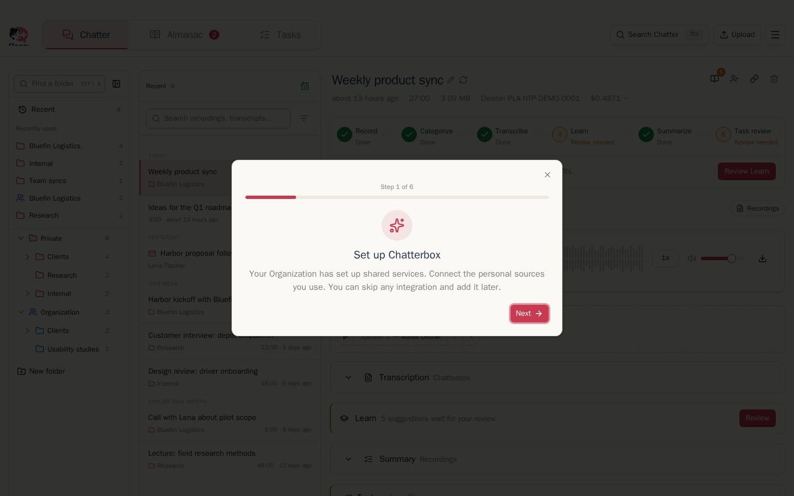
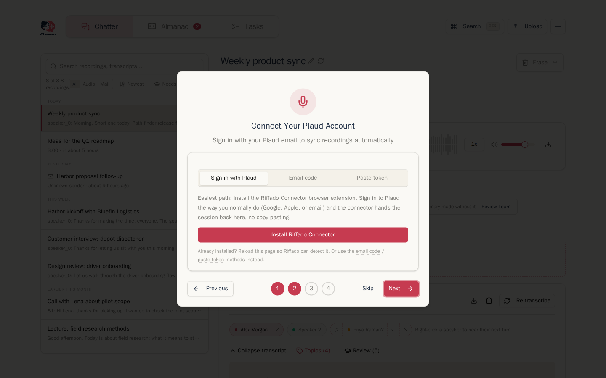
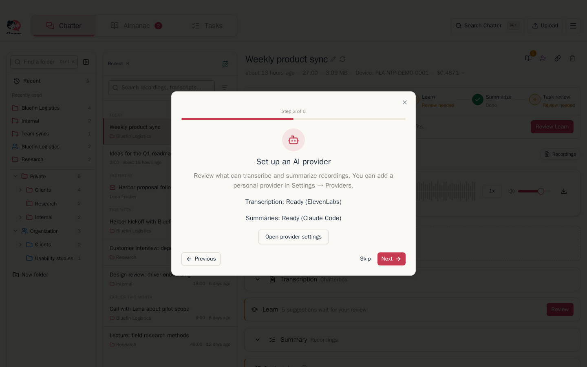
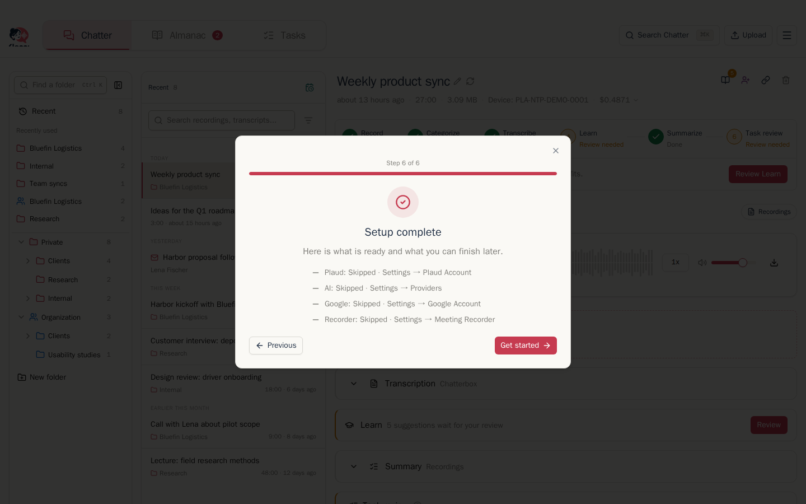
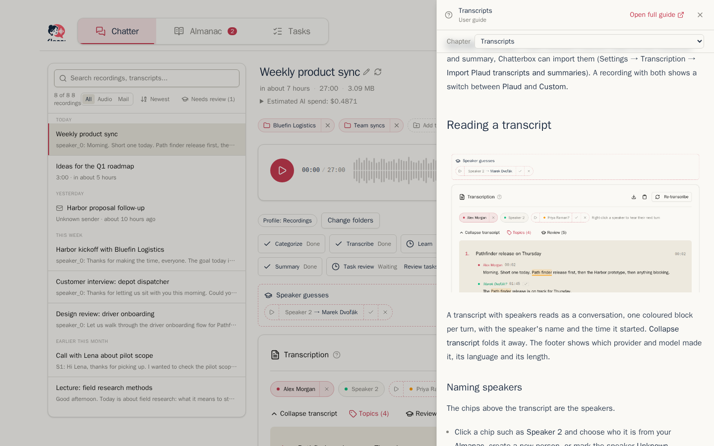
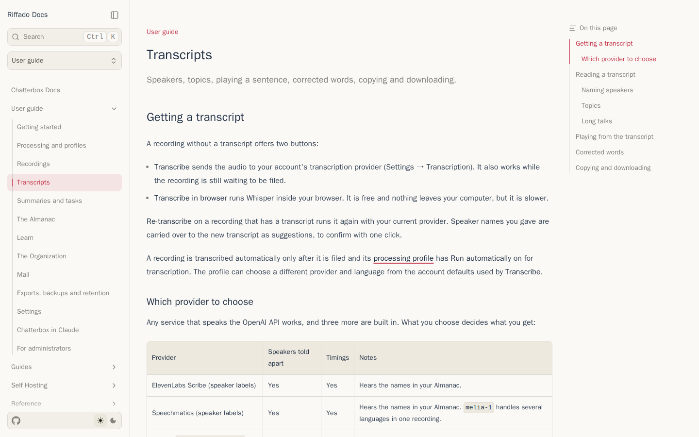
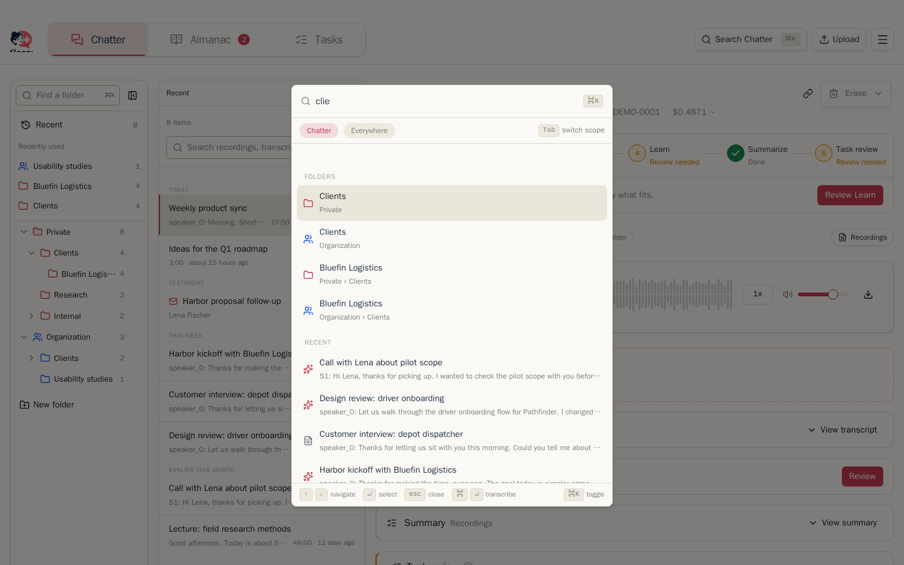

## Přihlášení

Otevřete svou adresu Klepna v prohlížeči a přihlaste se pomocí svého e-mailu a hesla. Na nové instanci s vlastním hostingem se první zaregistrovaný účet stává administrátorem.

Pokud vaše organizace používá jednotné přihlašování, na přihlašovací obrazovce se místo toho zobrazí jedno tlačítko, například **Přihlásit se přes Keycloak**. Váš účet se vytvoří při prvním přihlášení. Registrace může být na vaší instanci uzavřená; v tom případě požádejte svého administrátora o přístup.

## Průvodce prvním spuštěním

Při prvním otevření Klepny Vám krátký průvodce pomůže připojit služby, které používáte. Všechny integrace jsou nepovinné. Google, pošta a Claude se zobrazí jen tehdy, když jsou na Vaší instanci povolené.

Na instanci s vlastním hostingem a Organizací už máte k dispozici sdílené nahrávky a služby. Připojte jen své osobní zdroje. Pokud zvolení poskytovatelé Organizace pokrývají přepis a shrnutí, krok s AI se vynechá a závěrečný přehled uvede jejich názvy. Poskytovatel Claude Code nebo Codex z Organizace může vytvářet shrnutí, ale neumí přepisovat nahrávky. Pokud některá role chybí, průvodce ji pojmenuje a otevře nastavení poskytovatelů. Zavřením Nastavení nebo volbou **Zpět do průvodce** se vrátíte ke stejnému kroku a stav se znovu ověří.

Účet Organizace při volbě **Spustit nastavení znovu** vidí jen sdílené poskytovatele AI, výchozí volby a profily zpracování. Členové připojují osobní integrace ze svých účtů.

| Krok | Co dělá |
| --- | --- |
|  | **Vítejte.** Co Klepna umí: synchronizuje nahrávky, přepisuje je a pomocí AI je shrnuje. |
|  | **Připojte účet nahrávače.** Přihlaste se rozšířením prohlížeče, pomocí kódu zaslaného e-mailem nebo vložením tokenu. Poté Klepna začíná pravidelně stahovat Vaše nahrávky. Na vlastní doméně přidejte tento web ve vyskakovacím okně Plaud Connectoru a stránku znovu načtěte. |
|  | **Nastavte poskytovatele AI.** Otevře Nastavení, kde přidáte službu pro přepisy a shrnutí. Viz [Poskytovatelé AI](settings.md#ai-providers). |
| Kalendář Google a Meet (pokud jsou nastavené) | **Připojte Kalendář Google a Meet.** Přístup jen pro čtení pomůže rozpoznat schůzky a navrhnout mluvčí podle pozvaných hostů a účastníků Meet. |
| Nahrávání schůzek | **Nastavte nahrávání schůzek.** Nainstalujte rozšíření, otevřete jeho ikonu na liště a povolte tento web. Zde klikněte na **Připojit**, potom v rozšíření na **Confirm**. Postupujte podle výzev k souhlasu a zjištěného stavu; současné rozšíření může po souhlasu vyžadovat další otevření ikony na liště. Pokud se zobrazí upozornění, povolte v rozšíření mikrofon, jinak se Váš hlas nenahraje. Ruční připojení pomocí URL a klíče zůstává k dispozici. |
| E-mail (pokud je nastavený) | **Posílejte e-maily do Klepny.** Vaše adresa nepotřebuje nastavení. Posílejte nebo přeposílejte ze své firemní adresy. Pro automatické přeposílání od jiných odesílatelů použijte tajnou adresu v Nastavení → Pošta. Adresy se generují pro každou vlastní složku a mění se v jejím záhlaví. Pošta zaslaná v poli Komu nebo Kopie do složky Organizace čeká, až ji s Organizací nasdílíte. Průvodce ukáže i pozastavený příjem nebo nesplněné podmínky. |
| Claude (pokud je nastavený) | **Připojte Claude.** V Claude na claude.ai nebo v desktopové aplikaci otevřete **Customize → Connectors**, najděte firemní konektor, klikněte na **Connect** a přihlaste se firemním účtem. V konverzaci ho zapněte přes **+ → Connectors**. Pokyny pro osobní tarify a Claude Code jsou pod **Není v seznamu?**. Volba **Už mám nastaveno** zaznamená Vaše potvrzení, nikoli ověřené připojení. Viz [Claude](claude.md). |
|  | **Vše je připraveno.** Klikněte na **Začít**. |

Průvodce můžete znovu otevřít z Klepů, Almanachu i Úkolů z uživatelské nabídky přes **Spustit nastavení znovu**. Dokončené nastavení se tím nevynuluje. Závěrečný přehled ověří existující připojení i po návratu z přihlášení ke Googlu, aniž byste museli znovu navštívit předchozí kroky. **Další** pokračuje; přeskočení zaznamená jen **Přeskočit**. Probíhající či neúspěšné ověření a nutnost opětovného připojení se zobrazují samostatně.

## Orientace v prostředí

Horní lišta obsahuje tři sekce:

- **Klepy**: vaše knihovna. Vlevo zůstává seznam a panel složek, vpravo je detail vybrané nahrávky. Ještě před první nahrávkou můžete pomocí **Nová složka** knihovnu uspořádat, nebo rovnou synchronizovat či nahrát soubor.
- **Almanach**: osoby a objekty, o kterých Klepna ví. Odznak ukazuje počet kontrol čekajících na vás. Viz [Almanach](almanac.md).
- **Úkoly**: akční položky sledované napříč Vašimi nahrávkami a poštou. Odznak ukazuje nové úkoly a návrhy pro Vás. Viz [Shrnutí a úkoly](summaries-and-tasks.md#the-tasks-page).

Vpravo v liště:

- **Hledat v Klepech**, **Hledat v Almanachu** nebo **Hledat v úkolech** (nebo `Ctrl`/`⌘` + `K`) otevře vyhledávání v aktuální sekci.
- **Nahrát** přidá zvukový nebo video soubor z vašeho počítače. Tlačítko je dostupné také v Úkolech, Almanachu a Nastavení. Po nahrání se otevřou Nahrávky, nová položka bude vybraná a její pracovní postup bude na začátku.
- Nabídka účtu **≡** je dostupná ve všech třech sekcích: **Nastavení**, **Klávesové zkratky**, **Nápověda**, **Spustit nastavení znovu**, **Synchronizovat zařízení**, světlý či tmavý režim a **Odhlásit se**. Nastavení organizace se zobrazí, pokud k němu máte přístup. **Synchronizovat zařízení** stáhne nové nahrávky hned, bez čekání na automatickou synchronizaci.

Na úzké obrazovce se vyhledávání, Nahrát a ≡ zobrazí jako tlačítka s ikonami. Ikony všech tří sekcí zůstávají viditelné, název má jen aktuální sekce.

## Získání pomoci

Vyberte **≡ → Nápověda** nebo stiskněte `h` pro otevření této příručky vedle vaší práce, v kapitole týkající se aktuální obrazovky. Na stránce nahrávky se otevře [Přepisy](transcripts.md), na stránce Úkoly [Stránka Úkoly](summaries-and-tasks.md#the-tasks-page), v Nastavení se otevře právě zvolená sekce.

- **Kapitola** nahoře v panelu umožňuje přepnout na jinou kapitolu.
- **Otevřít celou příručku** otevře stejnou stránku v nové záložce s navigací a vyhledáváním.
- Malé **?** u některých funkcí, například na kartách Přepis a Shrnutí, v kontrole poznatků z Učení nebo u nastavení exportu složek, otevře panel přímo u této funkce.

Celá příručka je také dostupná na `/docs` na vaší adrese Klepna v sekci **Uživatelská příručka**.

## Příkazová paleta

Vyhledávání začíná v sekci, kterou máte otevřenou. Dvě tlačítka pod vyhledávacím polem ukazují aktuální sekci a **Všude**. Klávesou `Tab` mezi nimi přepnete bez zavření palety.

- **Klepy** hledají v nahrávkách a přepisech a nabízejí akce jako **Synchronizovat zařízení**, **Nahrát** a **Otevřít nastavení**. Klávesami `⌘`/`Ctrl` + `Enter` spustíte přepis vybrané nahrávky, která přepis ještě nemá.
- **Almanach** hledá osoby, věci všech typů a naučené přeslechy se správnými názvy. Výsledek ukazuje typ záznamu ve vašem jazyce a otevře jeho stránku v Almanachu.
- **Úkoly** prohledávají vaše i sledované úkoly. Otevřené jsou před hotovými, u každého je termín a zdrojová nahrávka. Vybraný úkol se otevře přímo, bez ohledu na filtry seznamu.
- **Všude** spojí výsledky ze všech sekcí a rozdělí je do skupin.

Výsledek vyberete šipkami `↑` a `↓`, otevřete klávesou `Enter` a paletu zavřete klávesou `Esc`. Vyhledávání v jednotlivých seznamech i filtry úkolů fungují dál nezávisle. Pokud vyhledávání hlásí, že mohou existovat další výsledky, upřesněte dotaz.

## Klávesové zkratky

| Klávesy | Akce |
| --- | --- |
| `⌘`/`Ctrl` + `K` | Příkazová paleta |
| `?` | Seznam zkratek |
| `h` | Otevřít tuto příručku na aktuální obrazovce |
| `,` | Nastavení |
| `/` | Hledat v seznamu nahrávek |
| `j` / `k` | Další / předchozí nahrávka |
| `Space` | Přehrát nebo pozastavit |
| `←` / `→` | Posun zpět / vpřed o 5 vteřin |
| `↑` / `↓` | Hlasitost |

## Jazyk

Klepna komunikuje anglicky i česky. Řídí se jazykem vašeho prohlížeče, dokud si v **Nastavení → Zobrazení → Jazyk** nezvolíte jiný. E-maily, které vám Klepna zasílá, se také posílají ve stejném jazyce.

Pokračujte: [Zpracování a profily](processing-and-profiles.md)
