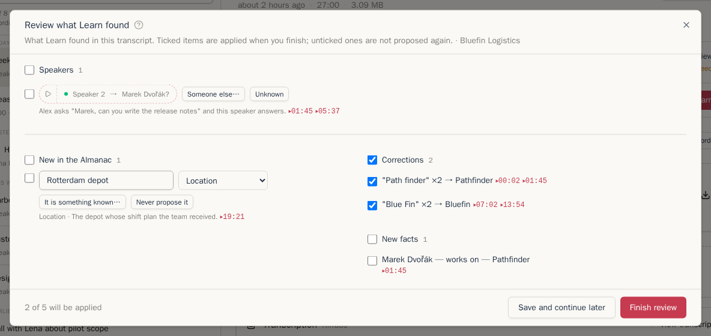
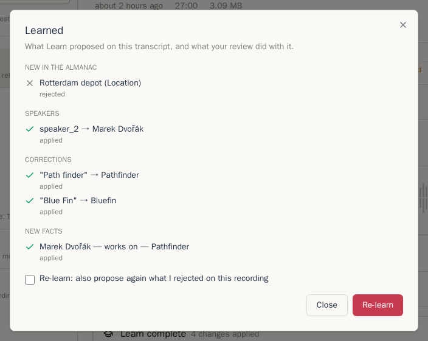

Learn reads a transcript against your [Almanac](almanac.md) and proposes what it found:

- **speaker names** for speakers nobody named yet,
- **corrections** of names the transcription misheard ("Path finder" for Pathfinder),
- **new people and things** worth adding to the Almanac,
- **facts** that were said ("Marek works on Pathfinder").

Nothing changes until you review the proposals.

Learn is available on self-hosted instances with an AI provider that can write summaries, on transcripts with timings (see [Which provider to choose](transcripts.md#which-provider-to-choose)).

## Running Learn

When Learn is manual, its widget says it is ready and offers **Learn**. Starting it opens a window; you can close that window while **Learn is reading the transcript** and leave the page. When it finishes, the same window holds the review.

When the item's processing profile has **Run automatically** on for Learn, Learn runs after a new transcript. Its review appears inline as part of the workflow. The strip says **Review needed** and its **Review Learn** action jumps to the review. The title, summary and topics wait so they use the corrected transcript. After 72 hours they continue without the review, but the review stays open and still blocks an intended Organization share.

## Reviewing

The review has the same contents inline or in the window opened by a run you started yourself. If you close a waiting window, **Review Learn** in the workflow strip reopens it:

- **Speakers**: who Learn thinks each unnamed speaker is, and why. **▷** plays the evidence. **Someone else…** picks another person, **Unknown** marks the speaker unknown.
- **New in the Almanac**: people and things Learn heard that the Almanac does not know. These start unticked. Correct the name or type before ticking, choose **It is something known…** if it is a record you already have under another name, or **Never propose it** to stop it being proposed on any recording.
- **Corrections**: misheard names, how often, and where. These start ticked.
- **New facts** and **Known facts** mentioned again.

Tick what is right, then click **Finish review**. **Save and continue later** keeps your ticks without applying anything. Unticked proposals are not proposed again on this recording.

You do not have to open the review: the proposals also appear in the transcript itself. A proposed correction is highlighted, and a proposed speaker shows as a name with **?**, each with a tick to accept it. **Speaker guesses** above the transcript lists the proposed names with **Accept all**.

## After the review

After the review, the widget folds to **Learn complete** with **View results** while the workflow continues. Open the results to see what happened to each proposal: applied, rejected, or why it was skipped. **Re-learn** starts another run in a window; tick **Re-learn: also propose again what I rejected on this recording** if you changed your mind about something.

Accepted corrections are kept beside the original text, never in place of it, so they can always be undone. See [Corrected words](transcripts.md#corrected-words).

When the processing profile has **Correct the transcript after Learn** on, Learn then reads the whole transcript once more with the Almanac at hand and fixes other misheard words. Each fix is underlined in amber and can be undone.

## Where reviews wait

- The **Needs review** filter above the recording list.
- The badge on **Almanac**, and the **Review** tab there.
- A recording with an unfinished review cannot be shared with the Organization until you finish it.

## Good to know

- Names are recognized in their inflected forms in the transcript's language, with or without accents: "Šimákem" finds Šimák.
- A speaker named only by a first name is marked as such. A first name two people in your Almanac share names neither of them.
- Saying a new record is one you already have teaches Chatterbox the misheard form as a nickname, so the next run recognizes it.
- A processing profile can give Learn its own provider and model, for example a stronger one than the summary uses. See [Processing and profiles](processing-and-profiles.md).

Next: [The Organization](organization.md)
