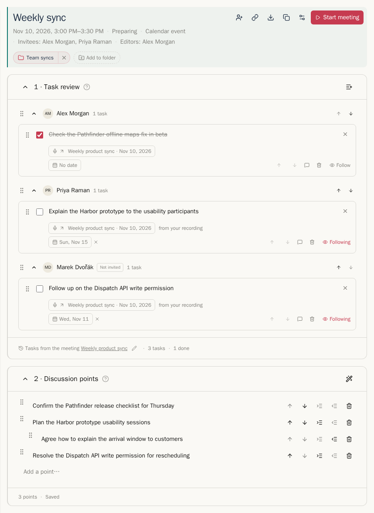
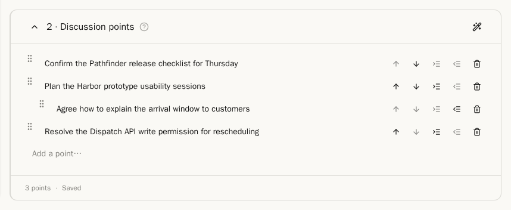
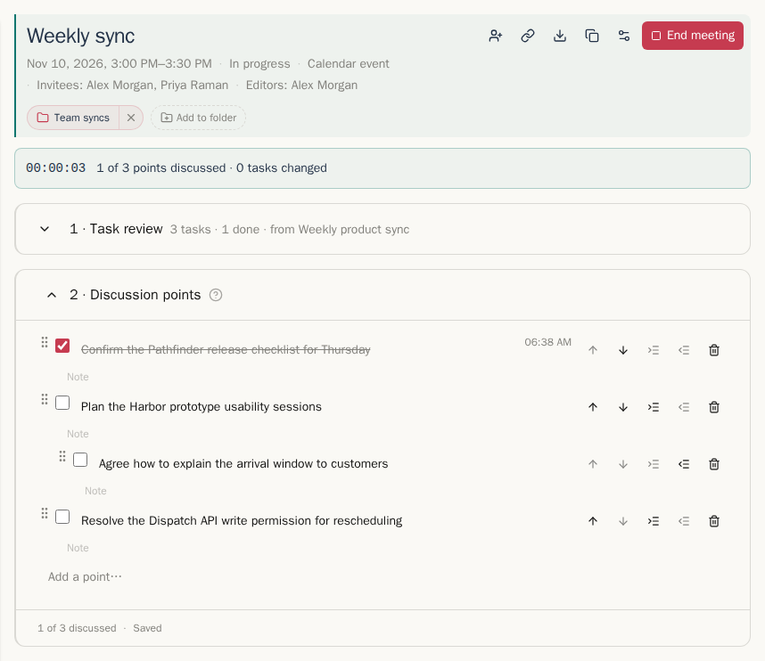

**Agenda** je to, co v Klepně připravujete pro schůzku, obvykle propojenou s událostí v Google Kalendáři. Založíte ji volbou **Připravit agendu** v řádku ikon složky (viz [Složky](recordings.md#folders)). **Nastavení agendy**, smazání agendy a zařazení do složek popisuje kapitola [Nastavení](settings.md#the-other-sections).

Agenda má dvě části: **1 · Kontrola úkolů** a **2 · Body k projednání**. Kolegové, kteří mohou agendu upravovat, na ní pracují současně s Vámi a jejich změny se načítají samy.

## Kontrola úkolů

Kontrola úkolů ukazuje úkoly z minulé schůzky seskupené podle řešitele: nejdříve pozvaní, potom lidé označení **Není mezi pozvanými** a nakonec úkoly **Bez řešitele**. Patička uvádí, odkud úkoly pocházejí. U události z opakované série je to poslední nahrávka této série před schůzkou, jinak nejnovější dřívější nahrávka s úkoly ve složkách agendy. Tužkou vyberete jinou nahrávku, nebo **Žádný** pro agendu bez úkolů z jiných schůzek.

- **Přidat starší úkoly…**, ikona v záhlaví sekce, přidá otevřené úkoly z dřívějších schůzek.
- Pořadí změníte přetažením úkolu za úchyt, jeho šipkami nebo klávesami **Alt+↑** / **Alt+↓** na úkolu, který má fokus.
- **×** vpravo nahoře u úkolu ho odebere jen z této agendy. Úkol samotný se nezmění. Odebrané úkoly jsou vypsané pod kontrolou s volbou **Obnovit**.
- Ikona koše mezi akcemi úkolu dělá něco jiného: **Zahodit** označí úkol jako zahozený všude, kde se objevuje.
- **Sledovat** se objeví úplně vpravo, když na úkol najedete myší; sledovaný úkol ukazuje **Sledujete** vždy. Viz [Poznámky a sledování](summaries-and-tasks.md#notes-and-follows).

Zaškrtnutím úkolu ho označíte jako hotový všude, kde se objevuje. Během schůzky přidá **Poznámka ze schůzky** poznámku, která patří k této agendě.

## Body k projednání

Body tvoří osnovu až o třech úrovních. Napište text do pole **Přidat bod…** na konci seznamu a klávesou **Enter** přidáte další bod.

**Navrhnout body**, ikona hůlky v záhlaví sekce, navrhne body podle dění ve složkách agendy od minulé schůzky. Použije poskytovatele shrnutí z Vašeho výchozího profilu zpracování. Návrhy se objeví pod agendou v části **Návrhy z dění ve složce od minulé schůzky**, každý s volbami **Přidat** a **Zamítnout**. Body, které minule zůstaly otevřené, najdete v části **Neprobráno minule**.

### Klávesové zkratky

| Klávesa | Akce |
| --- | --- |
| **Enter** | Přidá bod pod aktuální |
| **↑** / **↓** | Přejde na předchozí nebo další bod (z prvního nebo posledního řádku bodu) |
| **Tab** / **Shift+Tab** | Odsadí nebo předsadí bod |
| **Alt+↑** / **Alt+↓** | Posune bod i s jeho pod-body |
| **Backspace** v prázdném bodu | Smaže bod; jeho pod-body se posunou o úroveň výš |
| **Escape**, potom **Tab** | Opustí editor |

## Během schůzky

**Zahájit schůzku** v záhlaví přepne agendu do režimu schůzky: běží čas, u každého bodu je zaškrtávací pole pro označení jako probraný a ukazuje se počet probraných bodů a změněných úkolů. **Ukončit schůzku** ji ukončí.

U schůzky v prohlížeči ukazuje [rozšíření pro nahrávání schůzek](../guides/meeting-recorder.mdx#agendas) stejnou agendu v bočním panelu vedle schůzky, takže body odškrtáváte, zatímco nahráváte.

Když dorazí nahrávka schůzky, nebo když ji připojíte volbou **Připojit nahrávku…**, agenda přejde k nahrávce a je u ní jen pro čtení. Agenda, která skončila bez nahrávky, zůstává jako **Agenda bez nahrávky**: probrané body a poznámky zůstávají a změny úkolů už platí.

Dále: [Almanach](almanac.md)
