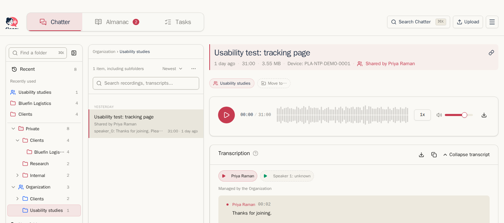
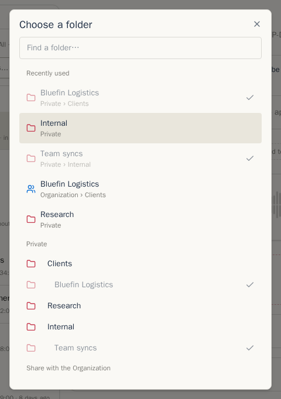
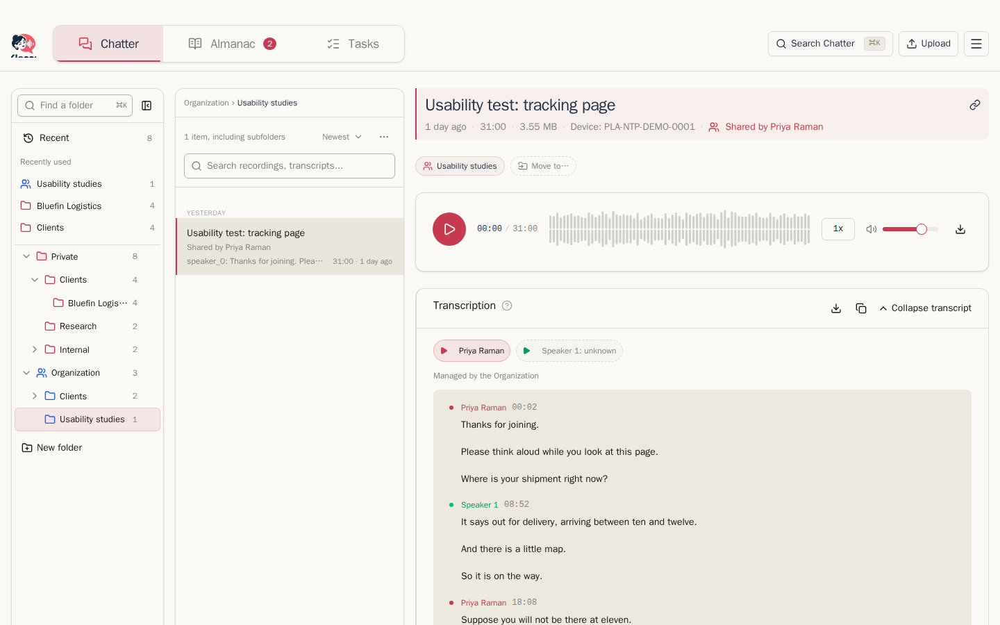

Jakmile to Váš administrátor nastaví, všichni v instanci sdílejí **Organizaci**: strom složek vedle Vaší části **Soukromé**, kde lze sdílet nahrávky a poštu s kolegy. Nic se nekopíruje. Sdílená položka zůstává ve vlastnictví osoby, která ji přinesla; Organizace čte jeden sdílený pohled.

## Sdílení položky

Složku Organizace vyberte na vložené kartě **Zařadit nahrávku** nebo **Zařadit e-mail**. Po zařazení můžete přidat další umístění v Organizaci pomocí **Přidat do složky** v řádku složek. Položku lze také přetáhnout na složku.

Tím nejprve vytvoříte zamýšlené umístění v Organizaci. Položka zůstane během zpracování podle profilu soukromá. Klepna ji automaticky nasdílí, jakmile je připravena ke čtení ostatními:

- u nahrávky existuje přepis,
- každý mluvčí je pojmenovaný nebo označený jako neznámý.

Kontrola úkolů sdílení nezdržuje. Kolegové uvidí navržený úkol až po jeho přijetí vlastníkem nebo kurátorem.

Řádek složek ukazuje zamýšlenou složku Organizace a pruh pracovního postupu přidá krok **Sdílet**, na kterém je vidět čekající kontrola. Sdílení zruší otevřený soukromý běh [Učení](learn.md). Jeho zjištění zůstanou soukromá. Pokud profil Organizace zapíná automatické Učení, spustí se nový běh v rozsahu Organizace a shrnutí počká na jeho kontrolu.

Pokud jste dokončili soukromou kontrolu Učení pro aktuální obsah položky, Klepna při sdílení předá potvrzené poznatky Organizaci bez dalšího potvrzení. Učení uvádí **Naučeno z kontroly vlastníka**, ukazuje počty použitých a přeskočených návrhů a v pracovním postupu je dokončené. Totéž platí pro e-maily. Kurátoři mohou spustit **Učit se znovu** a osoby i věci Organizace slučovat nebo mazat.

Položka zařazená s volbou **Bez automatického zpracování** se sama nenasdílí. U zamýšlené složky jsou v řádku akce **Sdílet nyní** a zrušení. Pruh uvádí **Na vás.** a čeká, dokud položku nenasdílíte nebo umístění nezrušíte.

Pošta poslaná přímo na adresu složky Organizace také začíná jako soukromé zamýšlené umístění, prochází stejnými kontrolami a automaticky se nasdílí. Viz [Pošta](mail.md).

## Sdílená položka

Každý může sdílenou položku otevřít a číst, přehrát nebo stáhnout sdílený zvuk a zařadit položku do dalších složek Organizace. V záhlaví je uvedeno, kdo ji sdílel, a u mluvčích nahrávky jen pro čtení je uvedeno **Spravuje Organizace**.

Během sdílení mohou název, přepis, mluvčí, shrnutí, témata a kontrolu Učení měnit vlastník položky a kurátoři Organizace. Ostatní členové mají obsah jen pro čtení. Změny z obou pohledů upravují jednu společnou verzi v rozsahu Organizace. Zpracování používá nastavení a šablony Organizace; mluvčí lze vybírat jen z osob Organizace a nové jméno se stane osobou Organizace. Sdílení nechá automatické zpracování vlastníka pokračovat a neoznačí dokončené kroky jako zastaralé.

Úkoly mají vlastní oprávnění. Vlastník domovské položky a kurátoři mohou sdílený úkol upravit, zrušit, uzavřít a sloučit. Jeho řešitel jej může také uzavřít nebo znovu otevřít. Úkol může shromažďovat zmínky z několika sdílených nahrávek a zpráv; viz [Úkoly napříč položkami](summaries-and-tasks.md#tasks-across-items).

Osoby uvedené ve sdílených nahrávkách se stávají **osobami Organizace**, viditelnými pro všechny v [Almanachu](almanac.md). Kurátoři se o ně starají: přejmenovávají je, slučují a mažou pro všechny. Stále si k osobám Organizace můžete vést soukromé poznámky a přiřadit jim vlastní přezdívky.

## Vzetí položky zpět

Chcete-li položku odebrat z Organizace, odeberte ji z poslední složky Organizace. Klepna Vás nejprve požádá o potvrzení a sdělí, co se stane podle retenčních pravidel. Sdílený pohled potom kolegům zmizí a položka bude opět soukromá.

Odebráním domovské položky úkolu z Organizace se domov přesune na nejnovější zbývající sdílenou zmínku. Pokud žádná nezůstane, úkol se stane soukromým spolu s odebranou položkou. Vymazání sdílené položky nebo její části ji nejprve odebere z Organizace.

## Profily Organizace

Profily Organizace jsou sdílené recepty zpracování pro složky Organizace. Členové je mohou používat a duplikovat do osobního profilu. Kurátoři mohou profily Organizace vytvářet, upravovat, archivovat, obnovovat a volit jako výchozí. Viz [Zpracování a profily](processing-and-profiles.md#profiles-are-processing-recipes).

## Poskytovatelé Organizace

**Nastavení → Poskytovatelé → Poskytovatelé organizace** uvádí sdílené přihlašovací údaje AI, které může používat každý člen. Členové vidí poskytovatele, model, adresu, cenu, výchozí role a stav zakázání jen pro čtení; API klíče se nikdy nezobrazují. Povoleného poskytovatele Organizace mohou zvolit ve vlastním nastavení přepisu, shrnutí, témat, názvů nebo Učení.

Pouze osoby s oprávněním `access.manage` mohou poskytovatele Organizace přidávat, upravovat, povolovat, zakazovat nebo mazat a nastavit výchozího poskytovatele Organizace pro každou roli. Člen, který si poskytovatele nezvolil, používá tento výchozí, a to i u soukromých položek. Správci vidí také **Využití podle členů**, včetně počtu volání a odhadované ceny. Tyto požadavky hradí účet Organizace. Každá správcovská změna se zapíše do auditního protokolu administrátora.

Noví členové nemusejí poskytovatele nastavovat. Bez poskytovatele připnutého v profilu se použije volba člena pro danou roli, jeho volba pro shrnutí u Učení, témat a názvů, výchozí poskytovatel Organizace pro danou roli, její výchozí poskytovatel shrnutí u navazujících rolí, nejstarší povolený vlastní poskytovatel chatu člena (jen pro chatové role) a nakonec nejstarší povolený vhodný poskytovatel Organizace. Pořadí určuje čas vytvoření a poté ID přihlašovacích údajů. Přepis přeskakuje poskytovatele pouze pro rozšíření; chatové role přeskakují poskytovatele pouze pro přepis. Výslovně zvolený chybějící nebo zakázaný poskytovatel způsobí chybu bez přechodu na jiného.

Správci vidí upozornění, pokud není zvolen výchozí poskytovatel přepisu nebo shrnutí, a mohou náhradního nastavit jako výchozího. Pokud vhodný poskytovatel neexistuje, upozornění vysvětluje, že členové poskytovatele potřebují. Karty jen pro čtení označují náhradního poskytovatele, kterého člen skutečně používá. Náhradní výběr vyžaduje povolenou Organizaci a oprávnění k jejímu použití; náklady hradí Organizace a platí obvyklé limity na člena. Výběr pro samotný účet Organizace a chování náhradního výběru v hostované verzi se nemění.

Ve výchozím nastavení může každý člen provést 60 volání za hodinu u každého poskytovatele Organizace. Po dosažení limitu se další volání daného člena odmítne až do obnovení hodinového okna, aniž by využilo limit jiného člena. Administrátor může limit instance změnit.

## Kurátoři a organizační účet

Při autorizaci přes poskytovatele identity jsou osoby s oprávněním `org.curate` kurátory a osoby s oprávněním `access.manage` spravují přístup a poskytovatele Organizace. V místní instalaci tyto povinnosti drží organizační účet. Kurátoři mohou:

- upravovat sdílené nahrávky a poštu,
- kontrolovat sdílené výsledky Učení a úkoly,
- spravovat profily, osoby, věci a navržené vztahy Organizace,
- procházet **Almanach → Péče → Možné duplicity**, porovnávat a slučovat záznamy Organizace nebo zvolit **Nejsou stejní**, aby se dvojice už nenabízela žádnému kurátorovi (viz [Péče](almanac.md#care-possible-duplicates)),
- nastavit export složek Organizace,
- zálohovat Organizaci s evidencí vlastníka každé položky.

Nastavení retence Organizace se vztahuje na sdílené položky po dobu jejich sdílení.

Dále: [Pošta](mail.md)
