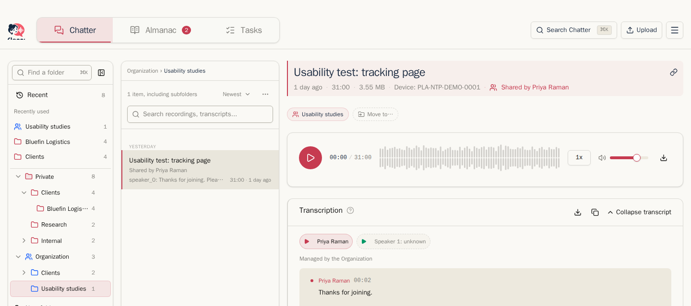
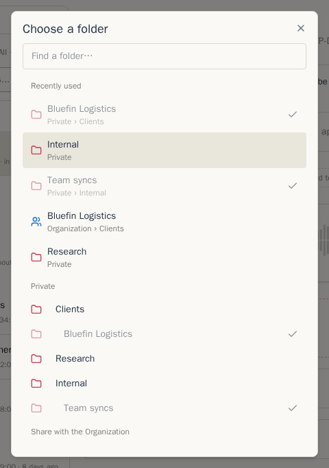
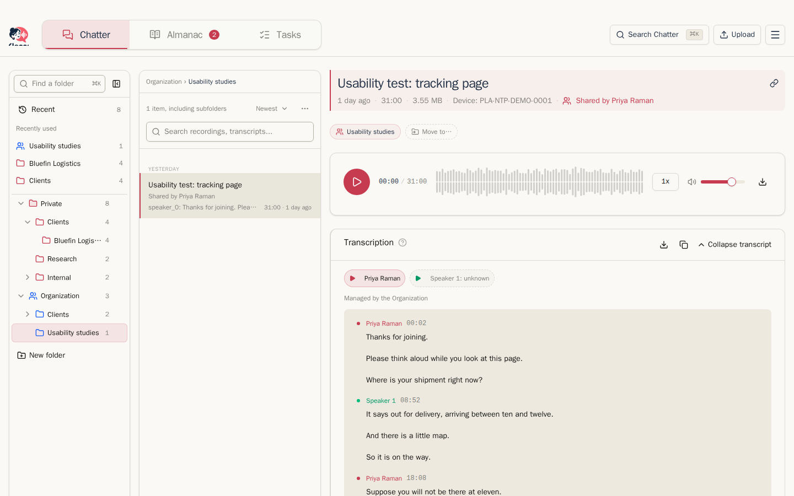

When your administrator has set it up, everyone on the instance shares an **Organization**: a folder tree next to your **Private** one, where recordings and mail can be shared with colleagues. Nothing is copied. A shared item stays owned by the person who brought it in; the Organization reads one shared view.

## Sharing an item

Choose an Organization folder in the inline **Categorize recording** or **Categorize email** card. After categorizing, use **Add to folder** in the folder row to add another Organization placement. You can also drag an item onto a folder.

This creates an intended Organization placement. Before a recording is shared for the first time, Chatterbox needs:

- a transcript with every speaker named or marked unknown,
- completed Learn in the private view, if the profile runs it,
- the automatic summary if it is still due or running, and the owner's review of proposed tasks.

The quick-finish and Skip options also complete their respective reviews when offered. The **Share** step shows what the recording is waiting for and links to the review. The same requirements apply when you file or move a recording directly into an open Organization folder. Only the owner sees proposed tasks from a recording or email until they accept them.

If a recording has no processing profile yet and filing it assigns a profile that runs Learn or Summary automatically, Chatterbox saves the folder as an intended placement. The recording stays private while those steps run and you finish any required reviews. Chatterbox then shares it in that folder. If closing an earlier task clears the last task decision, an intended share can also proceed once its other requirements are met.

If you finished the private Learn review for the item's current content, sharing publishes what you confirmed as Organization knowledge without another confirmation. The item's header **Knowledge** panel shows Learn as complete with the number of applied changes, and the workflow counts Learn as done. This also applies to mail. Curators can start **Re-learn** and merge or delete Organization people and things.

An item categorized with **Nothing automatic** is not shared by itself. Its intended folder offers **Share now** and a cancel button in the folder row. The strip says **Your turn.** and waits until you share or cancel it.

Mail sent to an Organization folder address starts with a private intended placement. Mail has no share gate. Automatic filing waits for any Learn hold for up to 72 hours. Filing mail by hand into an open Organization folder shares it immediately. Only the mail owner can review its task proposals. See [Mail](mail.md).

When an item is published to the Organization with a private Learn run still open, sharing closes that run and its findings stay private. This can happen with mail or with a recording whose open run is outside the share gate. Automatic Learn can then run in the Organization scope if the profile enables it.

## A shared item

Everyone can open and read a shared item, play or download shared audio, and file the item into other Organization folders. The header says who shared it, and read-only recording speakers say **Managed by the Organization**.

While an item is shared, its owner and Organization curators can change its title, transcript, speakers, summary, topics, and Learn review. Other members remain read-only. Only the item owner can hand-edit a generated summary or manage its private remarks; curators can regenerate it, with confirmation before replacing hand edits. See [Summary edits and remarks](summaries-and-tasks.md#edit-a-summary). Changes update the one version everyone reads, in the Organization scope, from either view. Runs use Organization settings and templates; speaker names come only from Organization people, and a new name becomes an Organization person. Sharing keeps the owner’s automatic pipeline running without marking finished steps outdated.

Tasks have their own permissions. The home item's owner and curators can edit, drop, close, and merge a shared task. Its assignee can also close or reopen it. A task may collect mentions from several shared recordings and mail; see [Tasks across items](summaries-and-tasks.md#tasks-across-items).

People named in shared recordings become **Organization people**, visible in everyone's [Almanac](almanac.md). Curators look after them: they rename, merge, and erase them for everyone. You can still keep private notes on an Organization person and give them nicknames of your own.

## Taking an item back

Remove the item from its last Organization folder to withdraw it. Chatterbox asks you to confirm first and says what happens under the retention rules. The shared view then disappears for colleagues and the item is private again.

Withdrawing a task's home item moves the home to the newest remaining shared mention. If no shared mention remains, the task becomes private with the withdrawn item. Erasing a shared item, or any part of it, withdraws it first.

## Organization profiles

Organization profiles are shared processing recipes for Organization folders. Members can use them and duplicate one into a personal profile. Curators can create, edit, archive, restore, and choose default Organization profiles. See [Processing and profiles](processing-and-profiles.md#profiles-are-processing-recipes).

## Organization providers

**Settings → Providers → Organization providers** lists shared AI credentials that every member may use. Members see each provider, model, address, price, role defaults, and disabled state as **Read-only**; API keys are never shown. They may choose an enabled Organization provider in their own transcription, summary, topics, title, or Learn settings.

Only people with `access.manage` can add, edit, enable, disable, or delete an Organization provider and set the Organization default for each role. A member who has not made a choice uses that Organization default, including for private items. They also see **Usage per member**, including calls and estimated cost. The Organization account pays for these requests. Every management change is written to the administrator audit log.

New members need no provider setup. Without a profile pin, resolution uses the member’s role choice, their summary choice for Learn/topics/titles, the Organization’s role default, its summary default for those following roles, the member’s oldest enabled chat provider (chat roles only), then the Organization’s oldest enabled suitable provider. Oldest means creation time, then credential ID. Transcription skips enhancement-only providers; chat roles skip transcription-only providers. An explicit missing or disabled choice fails without falling through.

Managers see a notice when no transcription or summary default is chosen and can make the fallback the default. If no suitable provider exists, the notice explains that members need a provider. Read-only cards identify the fallback a member actually uses. Fallback requires an enabled Organization and permission to use it; the Organization pays and the usual per-member limits apply. The organization account’s own resolution and hosted fallback behavior are unchanged.

Each member may make 60 calls per hour to each Organization provider by default. When the limit is reached, that member's next call is refused until the hourly window resets, without using another member's allowance. The administrator can change the limit for the instance.

## Curators and the organization account

With identity-provider authorization, people granted `org.curate` are curators and people granted `access.manage` manage access and Organization providers. On a local installation, the organization account holds those responsibilities. Curators can:

- edit shared recordings and mail,
- finish Organization-view Learn on an opened shared item and edit accepted shared tasks,
- manage Organization profiles, people, things, and suggested relations,
- review **Almanac → Care → Possible duplicates**, compare and join Organization records, or mark a pair **Not the same** so it stays dismissed for all curators (see [Care](almanac.md#care-possible-duplicates)),
- set up folder exports of Organization folders,
- back up the Organization, with each item's owner recorded.

Organization retention settings apply to shared items while they are shared.

Next: [Mail](mail.md)
