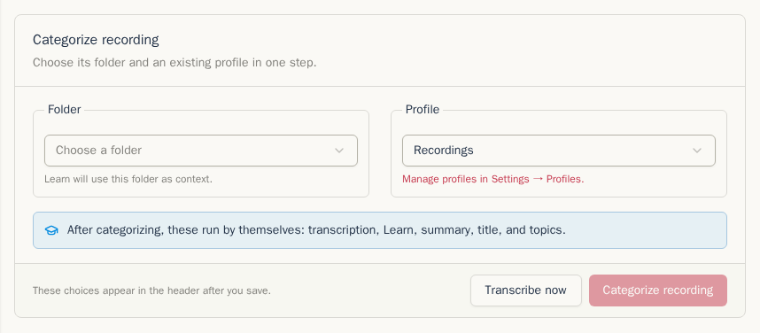
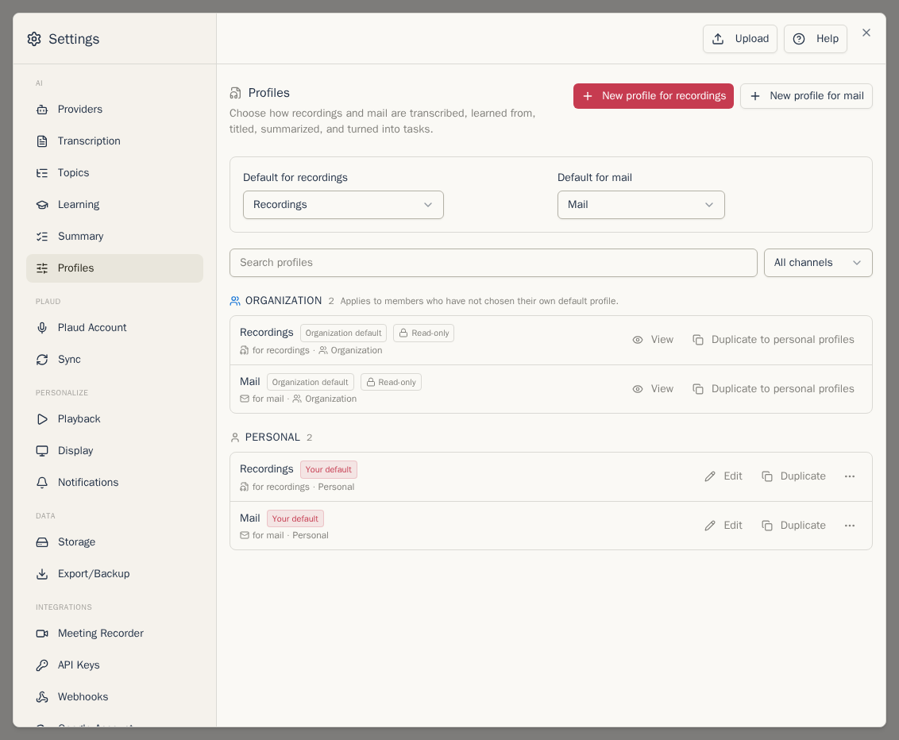
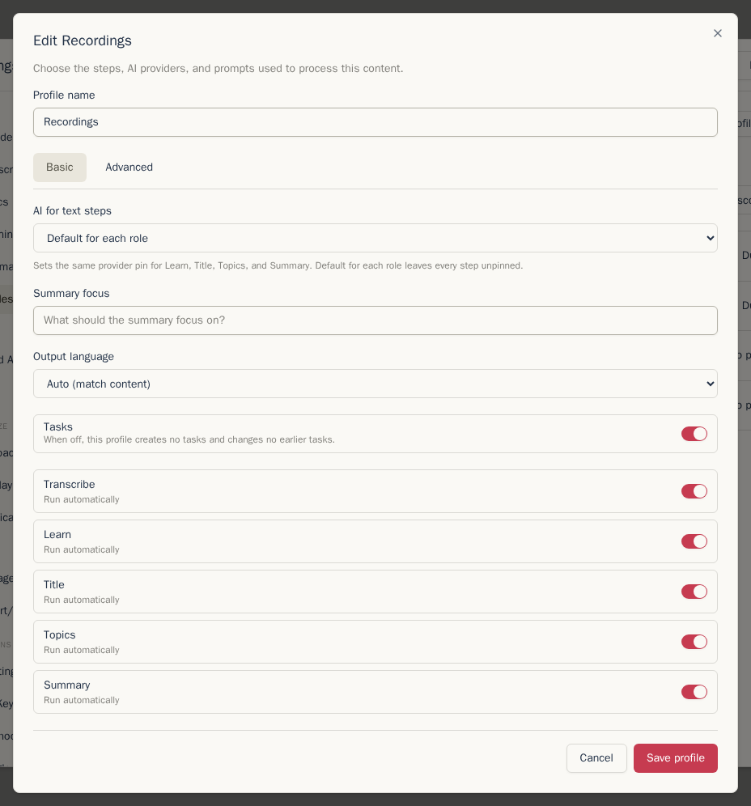
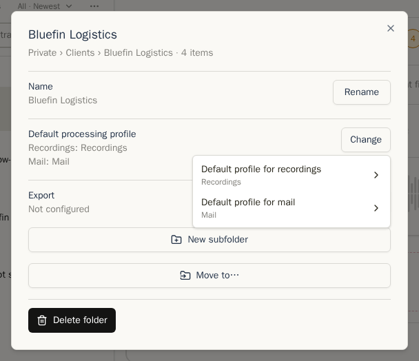
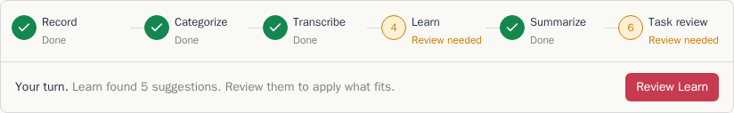

Nové nahrávky a pošta čekají na zařazení, než Chatterbox spustí placený krok AI. Složka tak může zvolit správný recept zpracování a nevznikne nechtěný přepis ani shrnutí.

## Zařazení nové položky

Otevřete položku. Prvním krokem pracovního postupu je vložená karta **Zařadit nahrávku** nebo **Zařadit e-mail**. V poli **Složka** vyberte jednu složku, nebo pomocí **Nová složka…** vytvořte složku první úrovně v části **Soukromé** či **Organizace**. V poli **Profil** zvolte **Výchozí profil Organizace**, konkrétní profil Organizace nebo osobní profil, případně **Bez automatického zpracování**.

Karta ukazuje popis profilu a větu popisující, co se spustí samo, například **Po zařazení se samy spustí: přepis, Učení, shrnutí, název a témata.** Při volbě **Bez automatického zpracování** uvádí **Nic se nespustí automaticky. Každý krok spustíte sami.** Volbu uložte tlačítkem **Zařadit nahrávku** nebo **Zařadit e-mail**. U zvuku je k dispozici také **Přepsat nyní**, pokud potřebujete přepis ještě před zařazením.

Položku můžete také přetáhnout na složku ve stromu. Položky adresované nebo nahrané přímo do složky toto čekání přeskočí. Patří sem pošta poslaná na adresu složky a relace Meeting Recorderu nebo nahrávání, u kterých jste vybrali složku.

Po zařazení se v řádku pod názvem zobrazí štítky složek, **Přidat do složky**, zamýšlené složky Organizace a vpravo štítek profilu. Jeho nabídka umožňuje změnit profil nebo zvolit **Bez automatického zpracování**.

Výběrem složky Organizace vytvoříte zamýšlené umístění. Položka zůstane během zpracování soukromá. Chatterbox ji automaticky nasdílí, jakmile projde kontrolami přepisu, mluvčích, Učení a úkolů. Při volbě **Bez automatického zpracování** místo toho čeká: zamýšlená složka v řádku nabízí **Sdílet nyní** a tlačítko pro zrušení.

## Profily jsou recepty zpracování

Profil zpracování je recept pro jeden druh položky. Profily zobrazíte a upravíte v **Nastavení → Profily**. Nový účet bez přístupu k Organizaci začíná se dvěma osobními profily: **Nahrávky** pro zvuk a **Pošta** pro poštu. Nový člen Organizace místo toho používá výchozí profily Organizace a začíná bez osobních profilů. Aktualizovaný účet si zachová stávající osobní výchozí profily a může mít další profily zkopírované z dřívějších šablon.

Každý profil obsahuje kroky pro daný druh položky. Profily nahrávek mohou přepisovat, spouštět Učení, vytvářet název, psát shrnutí, hledat témata a úkoly. Profily pošty začínají Učením a kroky shrnutí. Každý placený krok má vlastní přepínač **Spouštět automaticky**. Vypnutý krok lze stále spustit ručně.

Profil obsahuje také volby pro danou práci: poskytovatele a model, jazyk přepisu, instrukce shrnutí, jazyk a formát výstupu a nastavení funkce **Vícenásobné shrnování**. **Automaticky (podle obsahu)** zachová jazyk položky. Úprava profilu vytvoří novou revizi; rozpracované položky si ponechají revizi, se kterou začaly.

V horní části seznamu zvolíte samostatné výchozí profily pro nahrávky a poštu. Každý může sledovat aktuální výchozí profil Organizace, použít konkrétní profil Organizace nebo jeden z Vašich profilů. Osobní profily můžete vytvářet, duplikovat, mazat, archivovat a obnovovat. Smazání nepoužitého profilu jej odstraní natrvalo; pokud na něj odkazuje historie zpracování, Chatterbox jej odebere ze seznamů, ale ponechá jej pod **Archivované**, aby historie zůstala zachována. Ruční shrnutí může použít libovolný dostupný profil pro stejný druh položky. Výběr profilu shrnutí začíná profilem položky a v tomto prohlížeči si pamatuje poslední ruční volbu pro daný profil.

**Profily Organizace** jsou sdílené recepty. Členové je mohou používat na soukromé položky a duplikovat do osobního profilu. Štítek **Vaše výchozí** označuje profil, který právě používáte; **Výchozí profil Organizace** označuje volbu Organizace. Když sledujete výchozí profil Organizace, tento profil má oba štítky. Kurátoři mohou vytvářet a upravovat verze Organizace.

## Výchozí profily složky

Otevřete nastavení složky a zvolte **Výchozí profily**. Nahrávky a pošta mají samostatné výchozí hodnoty:

- **Dědit** použije nejbližšího předka s nastavenou volbou. Pokud ji nemá žádný, Chatterbox použije Váš výchozí profil pro daný druh položky.
- Výběrem profilu přiřadíte položkám zařazeným do složky tento recept.
- **Bez automatického zpracování** přiřadí běžný výchozí profil, ale vypne všechny automatické kroky. Kroky můžete stále spouštět ručně.

Pokud smažete osobní profil zvolený jako výchozí pro složku, složka se vrátí k volbě **Dědit**.

Pokud složky položky navrhují rozdílné výchozí profily, vložená karta **Zařazení** Vás požádá o výběr profilu. Složky Organizace používají profily Organizace.

## Pruh pracovního postupu

Pruh pod názvem položky zobrazuje všechny kroky v jednom řádku a potřebné zásahy:

| Fáze | Co dělá |
| --- | --- |
| **Nahrávka** nebo **Přijato** | Ukazuje, že nahrávka nebo e-mail dorazily. |
| **Zařazení** | Čeká na složky a určí profil. |
| **Přepis** | Vytvoří přepis nahrávky. U pošty se tato fáze nezobrazuje. |
| **Učení** | Najde jména, opravy a fakta ke kontrole. |
| **Shrnout** | Vytvoří název, shrnutí a témata zvolená profilem. |
| **Kontrola úkolů** | Čeká na kontrolu navržených úkolů a jejich změn. |
| **Sdílet** | Po splnění kontrol nasdílí zamýšlené umístění v Organizaci. |

U každého kroku je stav **Hotovo**, **Další**, **Ke kontrole**, **Běží**, **Ve frontě**, **Čeká**, **Selhalo**, **Zastaralé**, **Ručně** nebo **Přeskočeno**. **Ručně** znamená, že profil tento krok nespouští automaticky. **Zastaralé** znamená, že se po vytvoření výsledku změnil vstup. Na úzké obrazovce zůstane jeden řádek kroužků a pod ním se pojmenuje jen aktuální krok.

Věta pod kroky začíná **Na vás.**, **Pracuje se.**, **Ve frontě.**, **Problém.** nebo **Čeká na ostatní.** Vysvětluje, co bude následovat, a nabízí jedinou očekávanou akci, například **Zkontrolovat Learn**, **Zkontrolovat úkoly** nebo **Sdílet nyní**.

S postupem práce se v tomto pořadí otevírají prvky **Přepis**, kontroly Učení, **Shrnutí** a **Kontrola úkolů**. Hotové prvky se během další práce složí do jednoho řádku. Po dokončení pruh zmizí a položka vypadá jako dříve. Krok, který potom spustíte sami, například **Učení**, **Znovu shrnout** (u pošty **Shrnout znovu**), **Přepsat znovu** nebo **Rozpoznat témata**, se otevře v okně se stejným obsahem. Akce v pruhu přeskočí k vloženému prvku nebo toto okno znovu otevře.

U položky s volbou **Bez automatického zpracování** končí pracovní postup po kroku **Zařazení** a pruh zmizí. Výjimkou je zamýšlené umístění v Organizaci: pruh zůstane, dokud nepoužijete **Sdílet nyní** nebo umístění nezrušíte.

Pokud novější revize profilu nebo změněný vstup vyžaduje opakování automatické práce, tlačítko **Zpracovat znovu** spustí čekající kroky. Staré položky z doby před profily uvádějí **Zpracováno před zavedením profilů**, místo aby předstíraly použití receptu. Znovu se nespustí, dokud nezměníte jejich obsah nebo o to nepožádáte.

Dále: [Nahrávky](recordings.md)
