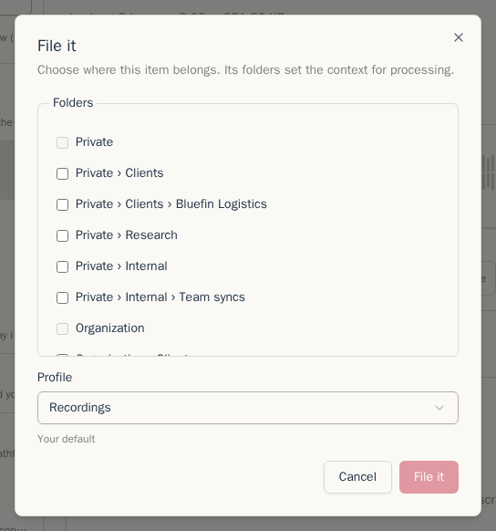
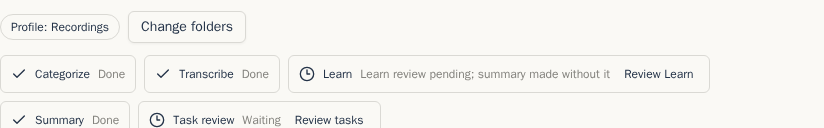

Nové nahrávky a pošta čekají na zařazení, než Chatterbox spustí placený krok AI. Složka tak může zvolit správný recept zpracování a nevznikne nechtěný přepis ani shrnutí.

## Zařazení nové položky

Otevřete položku a v záhlaví klikněte na **Zařadit**. Panel zařazení zobrazí stromy složek **Soukromé** a **Organizace**. Vyberte jednu či více složek, nebo klikněte na **Nová složka** a vytvořte ji bez opuštění panelu. Potom zvolte navržený profil, jiný profil, nebo **Bez automatického zpracování**, a klikněte na **Zařadit**.

Položku můžete také přetáhnout na složku ve stromu. Položky adresované nebo nahrané přímo do složky toto čekání přeskočí. Patří sem pošta poslaná na adresu složky a relace Meeting Recorderu nebo nahrávání, u kterých jste vybrali složku.

Pokud nahrávku potřebujete ihned, můžete ještě před zařazením kliknout na **Přepsat**. Ostatní automatické zpracování stále čeká na složku a profil.

Výběrem složky Organizace vytvoříte zamýšlené umístění. Položka zůstane během zpracování soukromá. Chatterbox ji automaticky nasdílí, jakmile projde kontrolami přepisu, mluvčích, Učení a úkolů. Zamýšlená složka Organizace se v záhlaví zobrazí s textem **sdílí se po kontrole**.

## Profily jsou recepty zpracování

Profil zpracování je recept pro jeden druh položky. Profily zobrazíte a upravíte v **Nastavení → Profily**. Nový účet začíná se dvěma profily: **Nahrávky** pro zvuk a **Pošta** pro poštu. Aktualizovaný účet může mít další profily zkopírované z dřívějších šablon, aby se zachovala jeho stávající nastavení.

Každý profil obsahuje kroky pro daný druh položky. Profily nahrávek mohou přepisovat, spouštět Učení, vytvářet název, psát shrnutí, hledat témata a úkoly. Profily pošty začínají Učením a kroky shrnutí. Každý placený krok má vlastní přepínač **Spouštět automaticky**. Vypnutý krok lze stále spustit ručně.

Profil obsahuje také volby pro danou práci: poskytovatele a model, jazyk přepisu, instrukce shrnutí, jazyk a formát výstupu a nastavení vícekrokového zpracování. **Automaticky (podle obsahu)** zachová jazyk položky. Úprava profilu vytvoří novou revizi; rozpracované položky si ponechají revizi, se kterou začaly.

Profily můžete vytvářet, duplikovat, archivovat, obnovovat a nastavovat jako výchozí. Ruční shrnutí může použít libovolný dostupný profil pro stejný druh položky. Výběr profilu shrnutí začíná profilem položky a v tomto prohlížeči si pamatuje poslední ruční volbu pro daný profil.

**Profily Organizace** jsou sdílené recepty. Členové je mohou používat a duplikovat do osobního profilu. Kurátoři mohou vytvářet a upravovat verze Organizace.

## Výchozí profily složky

Otevřete nastavení složky a zvolte **Výchozí profily**. Nahrávky a pošta mají samostatné výchozí hodnoty:

- **Dědit** použije nejbližšího předka s nastavenou volbou. Pokud ji nemá žádný, Chatterbox použije Váš výchozí profil pro daný druh položky.
- Výběrem profilu přiřadíte položkám zařazeným do složky tento recept.
- **Bez automatického zpracování** přiřadí běžný výchozí profil, ale vypne všechny automatické kroky. Kroky můžete stále spouštět ručně.

Pokud položku zařadíte do složek s rozdílnými výchozími profily, panel zařazení Vás požádá o výběr profilu. Složky Organizace používají profily Organizace.

## Ukazatel pracovního postupu

Ukazatel v záhlaví položky zobrazuje stav zpracování a potřebné zásahy:

| Fáze | Co dělá |
| --- | --- |
| **Zařadit** | Čeká na složky a určí profil. |
| **Přepis** | Vytvoří přepis nahrávky. U pošty se tato fáze nezobrazuje. |
| **Učení** | Najde jména, opravy a fakta ke kontrole. |
| **Shrnutí** | Vytvoří název, shrnutí a témata zvolená profilem. |
| **Kontrola úkolů** | Čeká na kontrolu navržených úkolů a jejich změn. |
| **Sdílet** | Po splnění kontrol nasdílí zamýšlené umístění v Organizaci. |

Stav vedle fáze uvádí **Čeká**, **Probíhá**, **Hotovo**, **Přeskočeno**, **Ručně** nebo **Zastaralé**. **Ručně** znamená, že profil tento krok nespouští automaticky. **Zastaralé** znamená, že se po vytvoření výsledku změnil vstup; použijte akci vedle fáze a krok spusťte znovu. Neúspěšný krok uvádí **Selhalo** a nabídne dostupnou akci pro opakování.

Pokud novější revize profilu nebo změněný vstup vyžaduje opakování automatické práce, tlačítko **Zpracovat znovu** spustí čekající kroky. Staré položky z doby před profily uvádějí **Zpracováno před zavedením profilů**, místo aby předstíraly použití receptu. Znovu se nespustí, dokud nezměníte jejich obsah nebo o to nepožádáte.

Dále: [Nahrávky](recordings.md)
