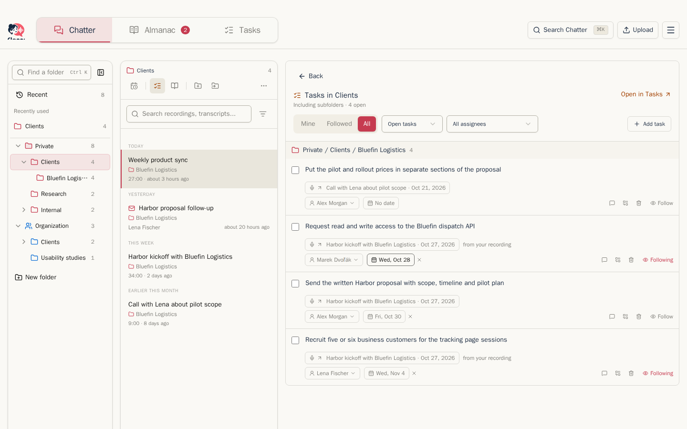

## Seznam nahrávek

Seznam Klepů vlevo zobrazuje nejnovější nahrávky a poštu jako první, seskupené podle dne. Každý řádek ukazuje název, případně podsložku a kdo položku sdílí, a potom náhled textu s délkou a datem.

- **Hledat** prohledává pole vybraná v části **Hledat v**: názvy, přepisy a text zpráv nebo shrnutí. Prohledává opravené přepisy. Text pošty nezahrnuje citované dřívější zprávy, podpisy ani právní dovětky.
- Nabídka **Vše · Nejnovější** určuje zobrazené kanály a řadí výsledek od nejnovějších, od nejstarších, podle názvu, délky nebo velikosti. Volba **Potřebuje zkontrolovat** se v nabídce objeví, když má Učení návrhy čekající na schválení. Viz [Učení](learn.md).
- Výběrem **Nedávné**, **Soukromé**, **Organizace** nebo konkrétní složky změníte umístění seznamu. Viz [Složky](#folders).
- Nabídka **⋯** na řádku otevře položku, z Nedávných či kořene knihovny ji přidá do složky, z vlastní složky ji přesune nebo stáhne zvuk či zprávu. Smazání je dostupné v soukromém pohledu; u sdílené položky upozorní na ztrátu přístupu kolegů.

## Přidávání nahrávek

Nahrávky přibývají třemi způsoby:

- **Z Vašeho záznamníku.** Klepna stahuje nové nahrávky z cloudu Vašeho záznamníku podle plánu, při otevření aplikace a pokaždé, když kliknete na **Synchronizovat zařízení**. Nastavení → Synchronizace určuje četnost.
- **Ze schůzky v prohlížeči.** Rozšíření Nahrávání schůzek pro Chrome, Edge, Brave a Vivaldi nahrává Váš mikrofon a kartu se schůzkou, odesílá zvuk už během nahrávání a nahrávku zařadí do zvolené složky, i když ji změníte uprostřed schůzky. Nainstalujete a propojíte ho v **Nastavení → Nahrávání schůzek**. Viz [Nahrávání schůzek](../guides/meeting-recorder.mdx).
- **Nahráním souboru.** Klikněte na **Nahrát** v Nahrávkách, Úkolech, Almanachu nebo Nastavení a vyberte zvukový nebo video soubor. Před nahráním můžete zvolit složku; taková nahrávka přeskočí čekání na zařazení a použije výchozí profil složky. Bez složky se otevře u kroku **Zařazení**. V Klepech se nahrávka otevře vpravo, pokud jste od začátku nahrávání nepřešli jinam. Jinak upozornění nabídne **Otevřít** a ponechá právě čtenou položku na místě. U videa si Klepna ponechá pouze zvuk: soubor se nahraje, zvuk se na pozadí oddělí a dostanete zprávu, až bude připravený. Jedno video se převádí vždy pouze jedno najednou.

Pokud Vaše instance přijímá poštu, objeví se ve stejném seznamu i e-maily, které na své adresy v Klepně pošlete nebo přepošlete. Viz [Pošta](mail.md).

Když máte otevřené **Klepy** a dorazí Vaše nová nahrávka nebo pošta, upozornění vpravo dole ukáže název a podrobnosti. Na telefonu je u spodního okraje. Výběr ani složka se nezmění. **Otevřít** otevře položku a tlačítko Zpět Vás vrátí. Novější příchozí položka upozornění nahradí; **+N dalších** počítá ostatní od jeho zobrazení. Upozornění zůstane, dokud ho nezavřete, neotevřete jeho položku nebo položka nezmizí. Položky, které v Klepech byly už při jejich otevření, a položky, které kolegové sdílejí do Organizace, upozornění nevyvolají. Volba **Zobrazovat oznámení o synchronizaci** ho nevypíná.

Účet bez vlastních položek začíná v **Organizaci**, pokud už kolegové něco sdíleli. V detailu se otevře nejnovější sdílená položka a nad seznamem jsou akce pro synchronizaci a nahrání. Pokud jsou obě knihovny prázdné, začněte pomocí **Nová složka**, **Synchronizovat zařízení** nebo **Nahrát**.

Pořizujete záznam schůzky v prohlížeči na Linuxu? Váš administrátor Vám může poskytnout **meetrec**, malý program z příkazového řádku, který zaznamená Vás i ostatní účastníky do jednoho souboru vhodného pro nahrání. Viz [Pro administrátory](administrators.md#meeting-recorder-meetrec).

## Stránka nahrávky

Klikněte na konkrétní nahrávku a otevře se napravo.

Nahoře naleznete:

- **Název.** Kliknutím na tužku vedle názvu jej můžete přejmenovat. První dokončené shrnutí může vytvořit jeden automatický název, který další zpracování nenahradí. Pomocí ikony obnovení můžete název kdykoli vytvořit znovu; pokud existuje shrnutí, použije se shrnutí, jinak přepis. Vlastnoručně zadaný název nebude nikdy přepsán automaticky.
- **Kdy, jak dlouhá, jak velká.**
- **Odhadovaná spotřeba AI** (viz níže).
- [Pruh pracovního postupu](processing-and-profiles.md#the-workflow-indicator). Dokud zbývá práce, ukazuje aktuální krok, kdo je na řadě, a jednu očekávanou akci.
- Před výběrem první složky vloženou kartu **Zařadit nahrávku**. Potom řádek složek se štítky, akcí **Přidat do složky**, zamýšlenými složkami Organizace a štítkem profilu vpravo. Nabídka štítku umožňuje profil změnit.
- **Vymazat** vpravo (viz níže).

Pod tím jsou přehrávač a prvky pracovního postupu. [Přepis](transcripts.md), kontrola Učení, [Shrnutí](summaries-and-tasks.md) a Kontrola úkolů se zobrazují v tomto pořadí, jak k nim postup dospěje. Hotový přepis a shrnutí se během další práce složí do jednoho řádku. Dokončené výsledky Učení najdete pod ikonou knihy **Znalosti** v záhlaví položky; **Zpět** vrátí detail.

### Přehrávač

Přehrávač zobrazuje nahrávku jako zvukovou vlnu. Kliknutím kamkoli skočíte na zvolené místo. **1x** mění rychlost, ikona reproduktoru a posuvník nastavují hlasitost a ikona stahování uloží původní zvukový soubor. Preferujete-li jednoduchý indikátor postupu, nastavte si ho v **Nastavení → Přehrávání → Styl posuvníku**.

### Kolik stojí AI

Kliknutím na **Odhadovaná spotřeba AI** zjistíte, kolik stála jednotlivá zpracování u této nahrávky: přepis, souhrn, témata, Učení i název. Dole pak vidíte, který poskytovatel a model danou operaci provedli. Ceny jsou dle oficiálního ceníku každého poskytovatele, nebo podle ceny, kterou jste zadali v nastavení poskytovatele (viz [Poskytovatelé AI](settings.md#ai-providers)). U Claude Code a Codex, které běží na základě předplatného, zobrazená částka ukazuje, kolik by to stálo přes API; není to poplatek. Požadavky uskutečněné před zavedením sledování nákladů nejsou započítány.

Částka zahrnuje vše, co se za nahrávku utratilo, bez ohledu na to, kdo platil. Když vše hradil jeden plátce, panel ho uvede, například „Platí Organizace.“; když jich bylo víc, u každého řádku je uvedeno, kdo platí. **≥ $0.45** znamená nejméně tuto částku: některé požadavky nemají cenu a panel je vypíše. **bez ceny** znamená, že cenu nemá žádný z požadavků. Pokud u položky neproběhla žádná evidovaná práce AI, nezobrazí se nic.

### Mazání

**Vymazat** odstraní části nahrávky a zbytek ponechá:

- **Vymazat místní zvuk** odstraní kopii nahrávky uloženou v Klepně. Přepis a souhrn zůstávají zachovány. Pokud je originál stále ve Vašem cloudu nahrávače, **Obnovit zvuk z Plaud** jej vrátí zpět.
- **Vymazat přepisy** a **Vymazat souhrny** odstraní pouze tyto položky.
- **Smazat všechna místní data** vymaže nahrávku z Klepny, ale originál zůstane ve Vašem cloudu rekordéru.
- **Přemístit originál Plaud do Koše** přesune originál do Koše na Vašem cloudu rekordéru.
- **Smazat všude** provede obojí. Akci potvrdíte opsáním názvu nahrávky.

Nahrávka sdílená s Organizací je nejprve odebrána z Organizace. Viz [Organizace](organization.md).

## Složky

Od šířky 1280 px je vedle seznamu a detailu panel složek. Ikona sbalení panelu vedle **Najít složku** (**Skrýt složky**) jej nahradí dlaždicemi nad seznamem; **Zobrazit složky** jej vrátí. Na užších obrazovkách používají stejná umístění dlaždice a drobečkovou navigaci. Na telefonu se položka otevře v detailu; tlačítko návratu uvádí aktuální umístění, například **Nedávné**, **Soukromé** nebo název složky, a obnoví stejné umístění i posun seznamu.

**Nedávné** obsahují vlastní položky. Účet Organizace zde vidí položky Organizace a nemá kořen Soukromé. Seznam složky zahrnuje i podsložky, jejichž názvy ukazuje na řádcích. Otevření položky zachová umístění; odkaz obsahuje složku i položku.

Od šířky 1024 px se panel složek a seznam posouvají samostatně a postupně načítají další položky. Umístění a ovládání seznamu zůstávají nahoře; dlaždice složek se posouvají s položkami. Na menší obrazovce se posouvá celá stránka. Větve pod první úrovní začínají sbalené. Prohlížeč si pro Váš účet pamatuje rozbalení a viditelnost panelu. **Naposledy použité** ukazuje počty položek až u pěti vlastních složek, které jste otevřeli nebo do nich zařadili položku. Dlouhá úroveň ukáže osm aktivních složek v panelu, šest v dlaždicích, v běžném pořadí; **Všech N** zobrazí ostatní. Hledání složek prohledává názvy i cesty bez ohledu na diakritiku. Složky najde také **⌘K**. Bez dotazu ukazuje jen naposledy použité složky; hledání nabídne nejvýše osm shod.

- **Soukromé** obsahují Vaše vlastní složky. Každá nahrávka je vždy ve složce Soukromé, bez ohledu na to, kde jinde se nachází.
- **Organizace** obsahuje složky sdílené s kolegy. Zobrazí se pouze, když má Vaše instance nastavenou Organizaci. Viz [Organizace](organization.md).

První složku vyberte na vložené kartě **Zařadit nahrávku**, nebo přetáhněte řádek nahrávky na složku. Po zařazení přidáte další umístění pomocí **Přidat do složky** v řádku složek:

Výběr složky otevře rovnou vyhledávací pole. Před psaním ukazuje naposledy použité složky a odsazené hierarchie Soukromé a Organizace. Cesty uvádí u naposledy použitých složek a výsledků hledání. Shody názvu jsou před shodami cesty. Již přiřazené složky zůstávají označené a nelze je zvolit znovu. Šipkami a Enter vyberete složku, Escape výběr zavře. Pokud nic neodpovídá, **Vytvořit složku „…“** nabídne volbu nadřazené složky. Přímo pod Organizací mohou tvořit složky jen kurátoři.

Jedna nahrávka může být ve více složkách najednou. Kliknutím na **×** u štítku složky ji odeberete z konkrétní složky. Zobrazuje se tu také zamýšlená složka Organizace; položka s volbou **Bez automatického zpracování** u ní nabízí **Sdílet nyní**, dokud ji nenasdílíte nebo umístění nezrušíte.

Složku spravujete řádkem ikon pod jejím názvem; počet položek je na konci řádku s názvem. Řádek podle Vašich oprávnění nabízí **Připravit agendu** (kalendář), **Úkoly ve složce** (seznam úkolů), **Znalosti** (kniha), **Nová podsložka**, **Přesunout do…** a úplně vpravo **Nastavení složky** (**⋯**). Ikona otevřeného pohledu je zvýrazněná; dalším kliknutím se vrátíte k položce. Přijaté složky nabízejí přípravu agendy, **Úkoly ve složce** a vlastní nabídku.

Kliknutím na složku zobrazíte její položky v seznamu. **Nová podsložka** a **Přesunout do…** otevřou malé okno; **Nová podsložka** je i v nabídce **⋯** a místní nabídce složky ve stromu. Přetahováním lze měnit pořadí i vnoření. Název aktuální složky nebo **⋯** na konci řádku ikon otevře její nastavení: přejmenování, sdílení, poštovní adresy, výchozí profily, export a smazání. Smazáním složky nesmažete její nahrávky:

Nastavení složky ukazuje **Název** jako text; **Přejmenovat** otevře pole pro úpravu. **E-mail do složky** ukazuje adresu, kopírování a čas posledního e-mailu, pokud je příjem pošty zapnutý. **Výchozí profil zpracování** ukazuje aktuální profily nahrávek a pošty včetně zděděných hodnot; **Změnit** je upraví. **Export** ukazuje cíle nebo **Nenastaveno**, s akcí **Změnit** či **Nastavit** pro export na disk nebo Google Drive. Viz [Zpracování a profily](processing-and-profiles.md#folder-default-profiles) a [Exporty, zálohy a uchovávání](exports-backups-retention.md#folder-exports).

### Úkoly ve složce

**Úkoly ve složce** ukážou v pravém panelu úkoly této složky i jejích podsložek, seskupené podle složek. Výchozí je **Všechny**; **Moje** a **Sledované** seznam zúží a filtry stavu a řešitele fungují jako na stránce Úkoly. **Přidat úkol** otevře formulář jako první řádek; u soukromé složky je tato složka předvybraná. Tlačítko je neaktivní, dokud úkol nepřidáte nebo formulář nezrušíte. **Otevřít v Úkolech** otevře stránku Úkoly se stejnou složkou a seznamem. Účet Organizace nemá **Moje** a vlastní úkoly přidávat nemůže.

### Znalosti složky

**Znalosti** v řádku ikon složky otevřou pohled pouze pro čtení místo detailu položky; pokud jsou otevřené **Úkoly ve složce**, nahradí je. Dalším kliknutím se vrátíte k položce; na telefonu **Zpět** vrátí seznam. Pohled je dostupný v každé soukromé složce i složce Organizace pro každého čtenáře.

Karty **Lidé**, **Věci**, **Opravy** a **Fakta** ukazují znalosti zmíněné položkami složky a jejích podsložek, počty použití, poslední použití a položky s doklady. Stav e-mailu osoby je informace, nikoli problém k opravě. Soukromé složky ukazují Vaše znalosti i znalosti Organizace; složky Organizace jen znalosti Organizace. Karty se načítají samostatně a delší seznamy mají ovládání Předchozí/Další.

Karta **Co dostanou modely** ukazuje seřazené výrazy pro přepis a přesný náhled JSON Almanachu pro model oprav přepisu. Limity a předpoklady náhledu popisuje [Almanach](almanac.md#folder-knowledge).

Další: [Přepisy](transcripts.md)
