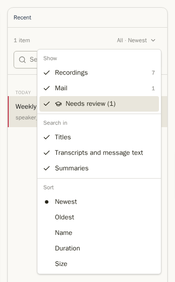
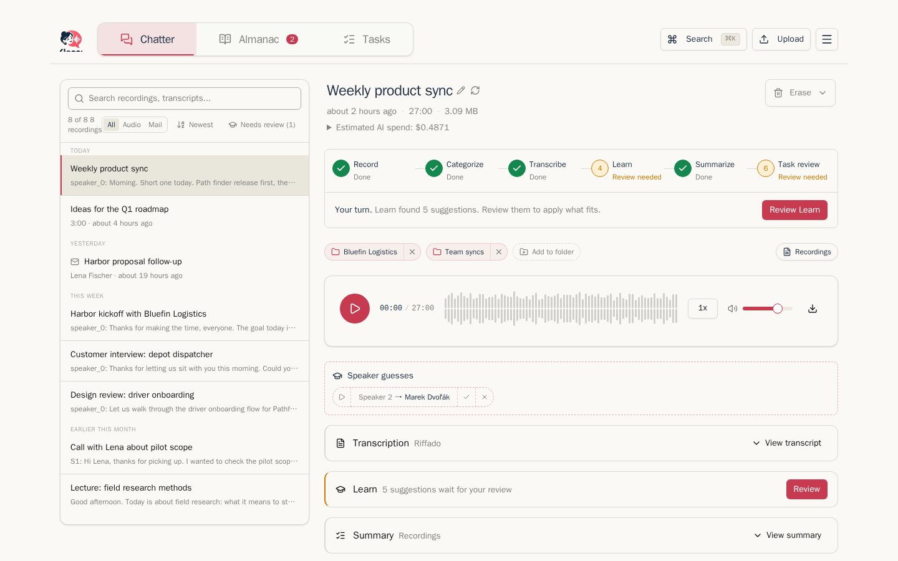
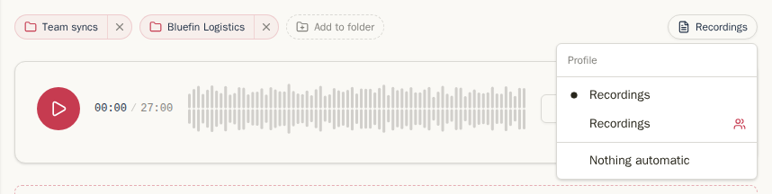
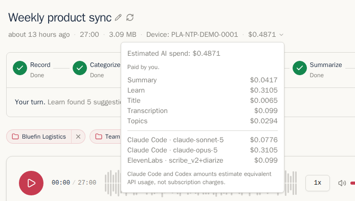
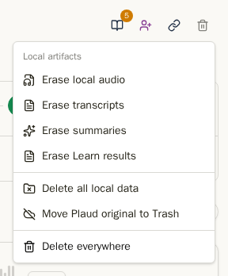
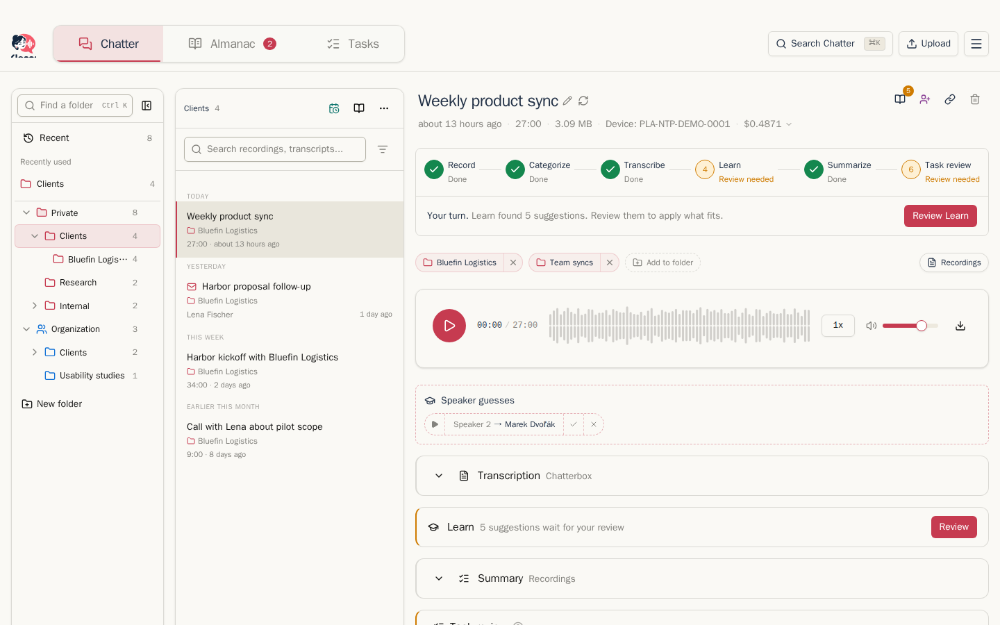
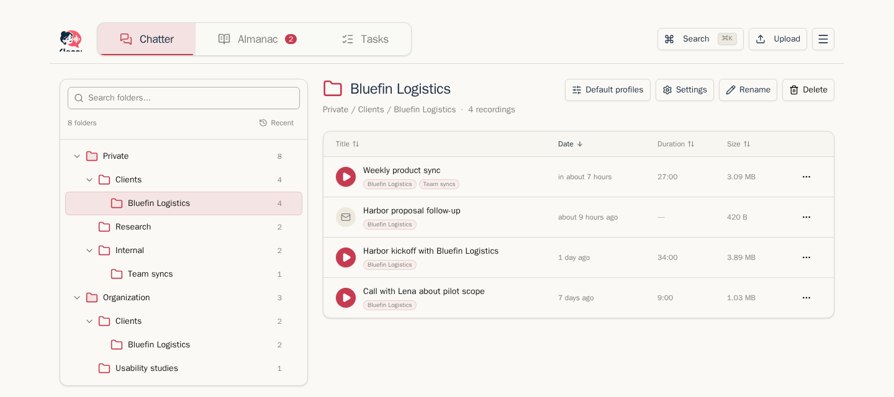

## Seznam nahrávek

Seznam Klepů vlevo zobrazuje nejnovější nahrávky a poštu jako první, seskupené podle dne. Každý řádek ukazuje název a první odpovídající slova, nebo odesílatele, délku a datum, pokud není k dispozici text.

- **Hledat** prohledává pole vybraná v části **Hledat v**: názvy, přepisy a text zpráv nebo shrnutí. Prohledává opravené přepisy. Text pošty nezahrnuje citované dřívější zprávy, podpisy ani právní dovětky.
- Nabídka **Vše · Nejnovější** určuje zobrazené kanály a řadí výsledek od nejnovějších, od nejstarších nebo podle názvu. Volba **Potřebuje zkontrolovat** se v nabídce objeví, když má Learn návrhy čekající na schválení. Viz [Learn](learn.md).
- **Organizovat** přepne seznam do režimu složek. Viz [Soubory](#folders).
- Nabídka **⋯** na řádku otevře detail nahrávky, stáhne zvuk nebo ji odstraní.

## Přidávání nahrávek

Nahrávky přibývají dvěma způsoby:

- **Z Vašeho záznamníku.** Chatterbox stahuje nové nahrávky z cloudu Vašeho záznamníku podle plánu, při otevření aplikace a pokaždé, když kliknete na **Synchronizovat zařízení**. Nastavení → Synchronizace určuje četnost.
- **Nahráním souboru.** Klikněte na **Nahrát** v Nahrávkách, Úkolech, Almanachu nebo Nastavení a vyberte zvukový nebo video soubor. Před nahráním můžete zvolit složku; taková nahrávka přeskočí čekání na zařazení a použije výchozí profil složky. Bez složky se otevře u kroku **Zařazení**. Nová nahrávka bude vybraná vpravo a pracovní postup bude na začátku. U videa si Chatterbox ponechá pouze zvuk: soubor se nahraje, zvuk se na pozadí oddělí a dostanete zprávu, až bude připravený. Jedno video se převádí vždy pouze jedno najednou.

Účet bez nahrávek přesto zobrazuje panel složek vlevo. Pomocí **Nová složka** tak můžete knihovnu uspořádat ještě před první synchronizací nebo nahráním.

Pořizujete záznam schůzky v prohlížeči na Linuxu? Váš administrátor Vám může poskytnout **meetrec**, malý program z příkazového řádku, který zaznamená Vás i ostatní účastníky do jednoho souboru vhodného pro nahrání. Viz [Pro administrátory](administrators.md#meeting-recorder-meetrec).

## Stránka nahrávky

Klikněte na konkrétní nahrávku a otevře se napravo.

Nahoře naleznete:

- **Název.** Kliknutím na tužku vedle názvu jej můžete přejmenovat. Vlastnoručně zadaný název nebude nikdy přepsán automaticky generovaným.
- **Kdy, jak dlouhá, jak velká.**
- **Odhadovaná spotřeba AI** (viz níže).
- [Pruh pracovního postupu](processing-and-profiles.md#the-workflow-indicator). Dokud zbývá práce, ukazuje aktuální krok, kdo je na řadě, a jednu očekávanou akci.
- Před výběrem první složky vloženou kartu **Zařadit nahrávku**. Potom řádek složek se štítky, akcí **Přidat do složky**, zamýšlenými složkami Organizace a štítkem profilu vpravo. Nabídka štítku umožňuje profil změnit.
- **Vymazat** vpravo (viz níže).

Pod tím jsou přehrávač a prvky pracovního postupu. [Přepis](transcripts.md), kontrola Učení, [Shrnutí](summaries-and-tasks.md) a Kontrola úkolů se zobrazují v tomto pořadí, jak k nim postup dospěje. Hotové prvky se během další práce složí do jednoho řádku.

### Přehrávač

Přehrávač zobrazuje nahrávku jako zvukovou vlnu. Kliknutím kamkoli skočíte na zvolené místo. **1x** mění rychlost, ikona reproduktoru a posuvník nastavují hlasitost a ikona stahování uloží původní zvukový soubor. Preferujete-li jednoduchý indikátor postupu, nastavte si ho v **Nastavení → Přehrávání → Styl posuvníku**.

### Kolik stojí AI

Kliknutím na **Odhadovaná spotřeba AI** zjistíte, kolik stála jednotlivá zpracování u této nahrávky: přepis, souhrn, témata, Learn i název. Dole pak vidíte, který poskytovatel a model danou operaci provedli. Ceny jsou dle oficiálního ceníku každého poskytovatele, nebo podle ceny, kterou jste zadali v nastavení poskytovatele (viz [Poskytovatelé AI](settings.md#ai-providers)). U Claude Code a Codex, které běží na základě předplatného, zobrazená částka ukazuje, kolik by to stálo přes API; není to poplatek. Požadavky uskutečněné před zavedením sledování nákladů nejsou započítány.

### Mazání

**Vymazat** odstraní části nahrávky a zbytek ponechá:

- **Vymazat místní zvuk** odstraní kopii nahrávky uloženou v Chatterbox. Přepis a souhrn zůstávají zachovány. Pokud je originál stále ve Vašem cloudu nahrávače, **Obnovit zvuk z Plaud** jej vrátí zpět.
- **Vymazat přepisy** a **Vymazat souhrny** odstraní pouze tyto položky.
- **Smazat všechna místní data** vymaže nahrávku z Chatterbox, ale originál zůstane ve Vašem cloudu rekordéru.
- **Přemístit originál Plaud do Koše** přesune originál do Koše na Vašem cloudu rekordéru.
- **Smazat všude** provede obojí. Akci potvrdíte opsáním názvu nahrávky.

Nahrávka sdílená s organizací je nejprve odebrána z organizace. Viz [Organizace](organization.md).

## Složky

Klikněte na **Organizovat** nad seznamem pro zobrazení svých složek.

- **Soukromé** obsahují Vaše vlastní složky. Každá nahrávka je vždy ve složce Soukromé, bez ohledu na to, kde jinde se nachází.
- **Organizace** obsahuje složky sdílené s kolegy. Zobrazí se pouze, když má Vaše instance nastavenou Organizaci. Viz [Organizace](organization.md).

První složku vyberte na vložené kartě **Zařadit nahrávku**, nebo přetáhněte řádek nahrávky na složku. Po zařazení přidáte další umístění pomocí **Přidat do složky** v řádku složek:

Jedna nahrávka může být ve více složkách najednou. Kliknutím na **×** u štítku složky ji odeberete z konkrétní složky. Zobrazuje se tu také zamýšlená složka Organizace; položka s volbou **Bez automatického zpracování** u ní nabízí **Sdílet nyní**, dokud ji nenasdílíte nebo umístění nezrušíte.

Pro správu složek použijte nabídku **⋯** vedle složky: **Nová podsložka**, **Přejmenovat**, **Přesunout do…** a **Odstranit**. Můžete také složky přetahovat pro změnu pořadí nebo vnoření. Smazáním složky nesmažete nahrávky v ní obsažené.

Kliknutím na složku zobrazíte její nahrávky v tabulce, kterou lze řadit podle názvu, data, délky nebo velikosti:

**Zpracování** u složky určuje profily pro nahrávky a poštu. **Export** nastavuje export na disk či Google Drive. Viz [Zpracování a profily](processing-and-profiles.md#folder-default-profiles) a [Exporty, zálohy a uchovávání](exports-backups-retention.md#folder-exports).

Další: [Přepisy](transcripts.md)
