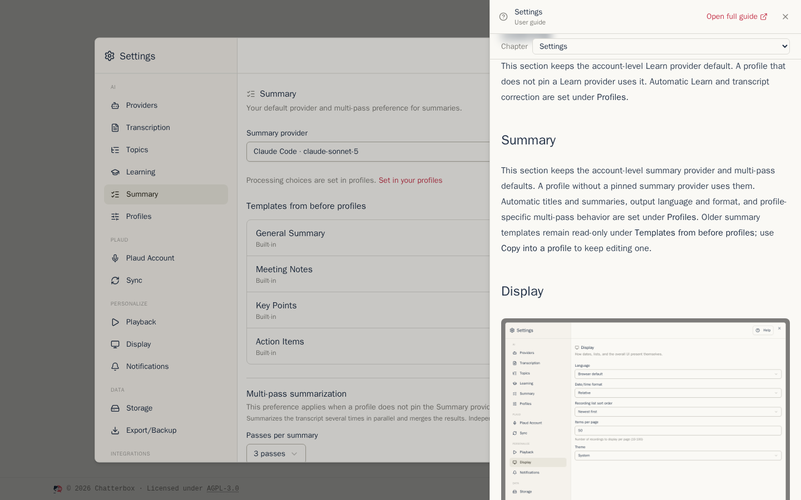
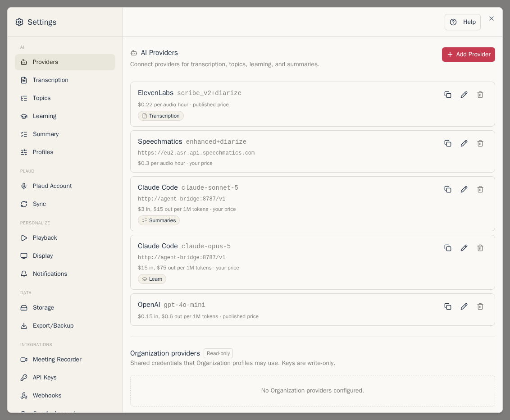
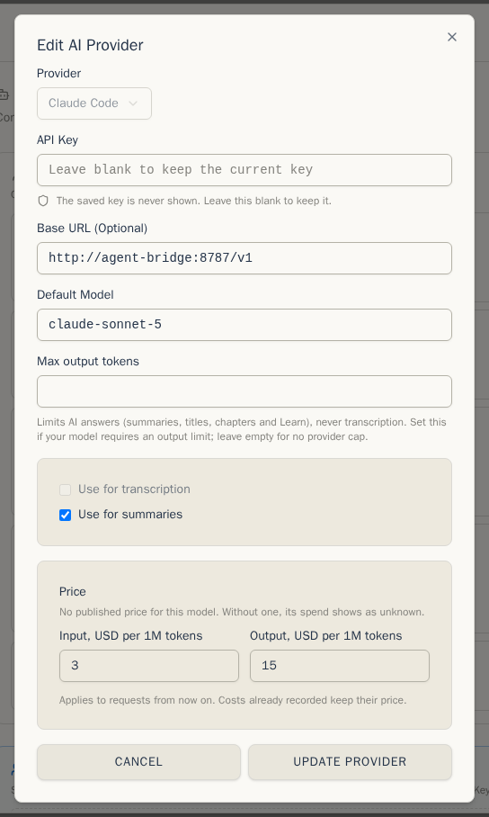
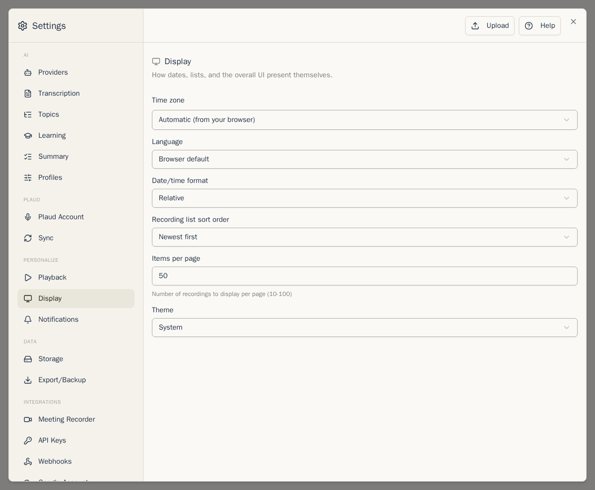

Open Settings from the account menu (the round button with your initial), or press `,`. The sections are grouped on the left.

**Help** at the top of Settings opens this guide at the section you have open.

## Profiles

**Settings → Profiles** is where you choose how recordings and mail are transcribed, learned from, titled, summarized, and turned into tasks. Profiles replace the old per-account automation switches and the template picker beside **Summarize**.

Use **New profile for recordings** or **New profile for mail**, or duplicate an existing profile. Each step has one **Run automatically** switch. The editor also holds its provider, model, language, instructions, output format, and multi-pass choices. You can set one default for recordings and one for mail, archive profiles you no longer use, and restore them later.

If the Organization is enabled, members see Organization profiles and can duplicate them into personal ones. Curators can edit the shared versions. See [Processing and profiles](processing-and-profiles.md).

## AI providers

**Settings → Providers** separates **Your providers** from **Organization providers**. Use the **Add provider** button in the card where the key belongs, choose the service, paste its API key, and pick a model. Chatterbox comes with presets for OpenAI, Groq, Together AI, OpenRouter, Google Gemini, ElevenLabs, Speechmatics, LM Studio and Ollama, and **Custom** takes any service with an OpenAI-compatible address. Keys are stored encrypted and never shown again.

- **Price.** Chatterbox knows the published prices of common models. For any other model, or if you pay a different price, enter it here. The [AI spend](recordings.md#what-the-ai-cost) of new requests uses it; costs already recorded keep their price.
- **Duplicate** makes a second personal or Organization provider from the same key, for example a stronger model for Learn. The key is reused without being shown.
- **Disable** keeps the key saved but removes the provider from new selections. A profile or account role that explicitly points to it stops with an error until you enable it or choose another provider.
- **Claude Code** and **Codex** run on a Claude or ChatGPT subscription instead of an API key, through a bridge your administrator sets up. See [For administrators](administrators.md#claude-code-and-codex-subscriptions).

Some providers only transcribe (ElevenLabs, Speechmatics). Summary steps then need a second provider.

Members inspect **Organization providers** as **Read-only**. People with `access.manage` can add, duplicate, edit, disable, enable, and delete them, and can see usage per member in the same card. See [Organization providers](organization.md#organization-providers).

## Transcription

**Transcription** now holds account defaults for **Transcribe**, generated titles when a profile does not pin a provider, and imported recorder content. It includes:

- the default transcription and title providers,
- **Import Plaud transcripts and summaries** and **Sync titles to Plaud**,
- **Primary transcript** when both Plaud and your provider have made one,
- **Default transcription language**, used when you transcribe now.

Automatic transcription, title generation, and their profile-specific providers are set under **Profiles**. Old title templates remain under **Templates from before profiles** and can be copied into a profile.

## Topics

This section keeps the account-level topics provider default. A profile that
does not pin a topics provider uses it. Automatic topic detection is set under
**Profiles**. Older topic templates remain read-only under **Templates from
before profiles**; use **Copy into a profile** to keep editing one.

## Learning

This section keeps the account-level Learn provider default. A profile that
does not pin a Learn provider uses it. Automatic Learn and transcript
correction are set under **Profiles**.

## Summary

This section keeps the account-level summary provider and multi-pass defaults.
A profile without a pinned summary provider uses them. Automatic titles and
summaries, output language and format, and profile-specific multi-pass behavior
are set under **Profiles**. Older summary templates remain read-only under
**Templates from before profiles**; use **Copy into a profile** to keep editing
one.

## Display

**Language** (English or Čeština), how dates are shown, the order of the recording list, how many recordings a page shows, and the theme.

## The other sections

- **Plaud Account**: connect, reconnect or disconnect your recorder account.
- **Sync**: automatic sync and how often it runs.
- **Playback**: default speed and volume, playing the next recording automatically, waveform or progress bar.
- **Notifications**: browser, email and Bark notifications for new recordings.
- **Storage**: space used, and [Auto-delete old data](exports-backups-retention.md#deleting-old-data-automatically).
- **Export/Backup**: [exports and backups](exports-backups-retention.md#backups).
- **API Keys** and **Webhooks**: connect Chatterbox to other tools.
- **Google Account**: connect the Google account used for [Google Drive exports](exports-backups-retention.md#to-google-drive).

Next: [Chatterbox in Claude](claude.md)
