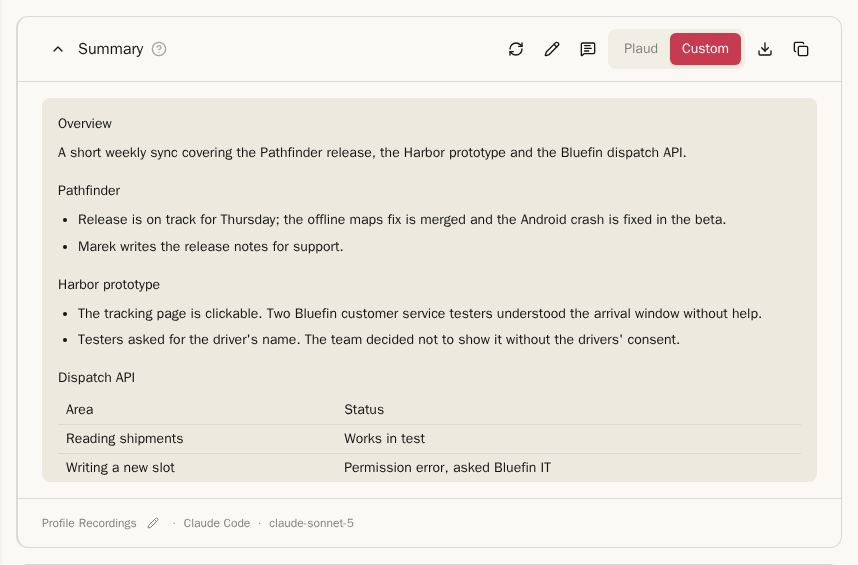
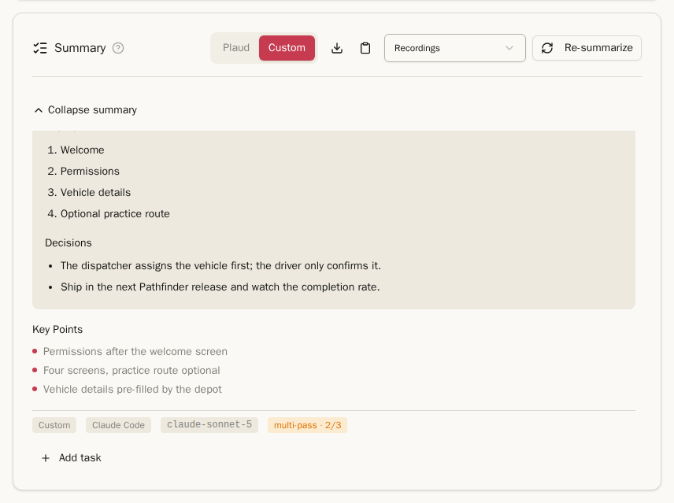
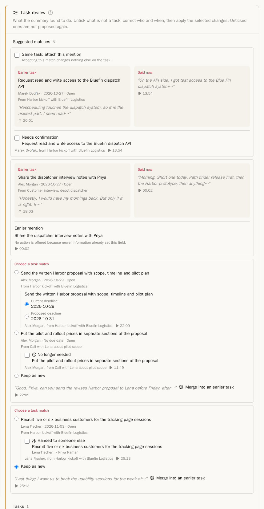
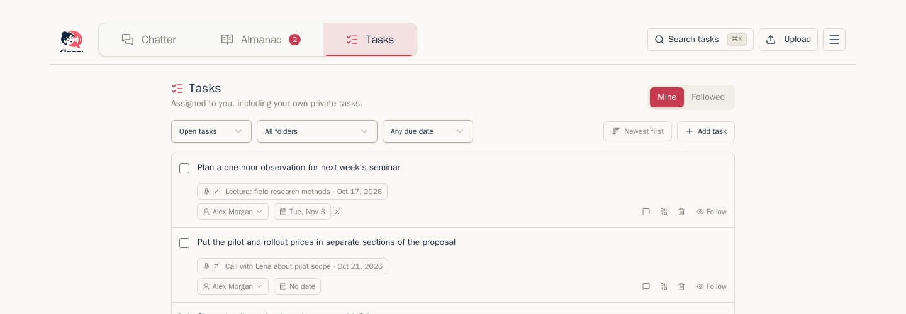
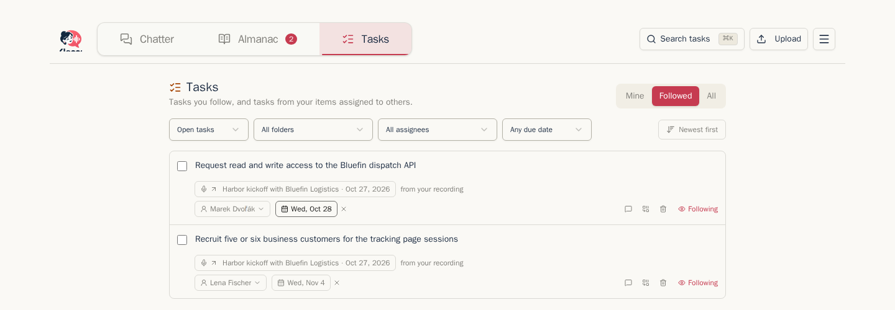

## Summaries

Once a recording has a transcript, the **Summary** card below it can summarize it. Mail has the same summary card.

1. Pick a processing profile in the drop-down next to the button. It starts on the item's profile. If you choose a different one, Chatterbox remembers that choice in this browser for other items with the same assigned profile.
2. Click **Summarize**, or **Re-summarize** to replace an existing summary.

The manual picker can use any available profile for that kind of item. The profile supplies the summary instructions, output language and format, provider, task detection, and multi-pass settings. See [Processing and profiles](processing-and-profiles.md).

While it runs, the card shows how long it has taken and, for a multi-pass summary, how far it is: `Summarizing — 1/3 passes`, then `Merging 3 passes…`. You can leave the page; the summary keeps going and is there when you come back.

Summaries are written in Markdown, so headings, lists and tables show as such. **Key Points** follow the text. The two icons copy the summary or download it as a Markdown file.

If you correct names in the transcript after the summary was written, the summary shows **May contain stale names or terms** with a **Regenerate** link. The workflow indicator also marks work made from older inputs as **Outdated**.

### Summary instructions and multi-pass

Chatterbox includes summary instructions such as **General Summary**, **Meeting Notes**, **Key Points**, and **Action Items**. They now live inside processing profiles rather than in the summary picker. Edit the profile to change the focus, instructions, output language, or output format.

A profile can run a summary 2 to 5 times and merge the results, so a point only one pass noticed still makes it into the summary. It costs about as many times more as there are passes. The footer says **multi-pass · 3**. When a pass failed and the summary was made from fewer, the badge turns amber, for example **multi-pass · 2/3**; hover over it to see why.

## Tasks across items

### Tasks from a summary

A summary looks for things someone agreed to do. A task no longer belongs to one summary: it collects mentions from recordings and mail filed in its folder scope. **Where it was said** opens the audio passage or highlights the relevant mail text. **Earlier mention** shows older evidence without changing the task.

Click **Review tasks** on the summary to review new tasks, matches, and changes:

- A new action can show **Suggested matches** to earlier open tasks from the same folder scope. One clear candidate is ticked only when its evidence is direct and verified. A quoted or unverified statement is never ticked. Deadline and completion changes are never ticked automatically.
- When several candidates are plausible, choose the right one or **Keep as new**. **Merge into an earlier task** searches all open tasks in the folder scope, not only the suggested candidates.
- A deadline change shows the **Current deadline** and **Proposed deadline**. A completion is marked **Needs confirmation**. An older statement than the task's latest edit appears as **Earlier mention** and needs no decision.
- A summary can also propose **No longer needed** or **Handed to someone else**. These are never preselected. An unknown assignee is shown for checking, not silently created.
- Untick a new task that is not real. Correct its text, assignee, or deadline before accepting it. **Add task** adds one the summary missed. **Save and continue later** preserves the review without applying it.

<!-- TODO verify after 4a-fixB/C -->
The review shows one card per task. A match is the main decision; deadline, completion, **No longer needed**, and **Handed to someone else** changes for that task appear beneath it.

<!-- TODO verify after 4a-fixB/C -->
After accepting a match, the item's task list lets the item owner undo it, or lets curators do so on a shared item. Undoing separates this mention into its own task. Field changes already applied to the earlier task stay applied.

Accepted tasks are listed on the item. Tick one off when it is done, or use **Add task** to add one by hand. A task lives while at least one mention exists, even if the summary that first found it is replaced.

## Routed proposals

If you review a proposed change but do not have permission to apply it, Chatterbox routes it to someone who does. **Proposals for you** on the Tasks page is the inbox for those decisions, and its navigation badge shows how many wait. Permission is checked again when a proposal is applied.

On a shared task, its home item's owner and Organization curators may edit, change its deadline or assignee, drop it, merge it, and close it. The assignee may also close or reopen it. On a private task, only its owner may do those things. These task rights are an exception to the other editing rules for shared items.

When the home item is deleted, the newest surviving mention in the same scope becomes home. If none remains, the task disappears. When a shared home item is withdrawn from the Organization, the newest remaining shared mention becomes home. If none remains, the task becomes private with the withdrawn item. The withdrawn mention is no longer visible to the Organization. Retention that removes audio or generated content does not move the home.

## The Tasks page

**Tasks** in the top bar lists tasks from recordings and mail.

- **Mine**: tasks assigned to you. Chatterbox knows which person in the Almanac is you by your email address; open your own person in the Almanac and choose **This is me** if your tasks do not show here.
- **Tracked**: the other tasks from your items, assigned to someone else or to nobody yet.

The filters show open, done or dropped tasks, tasks from one folder, and tasks that are overdue, due this week or have no date. Sort by newest or by due date. Each task offers the actions you have permission to use and **Where it was said** for every mention.

Use **Merge into an earlier task** here when two task rows are the same work. The target keeps its fields. Differences that require another person's authority are routed as proposals rather than applied silently. Private and Organization tasks cannot be merged in a way that hides an Organization task from members.

Next: [The Almanac](almanac.md)
