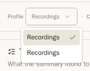
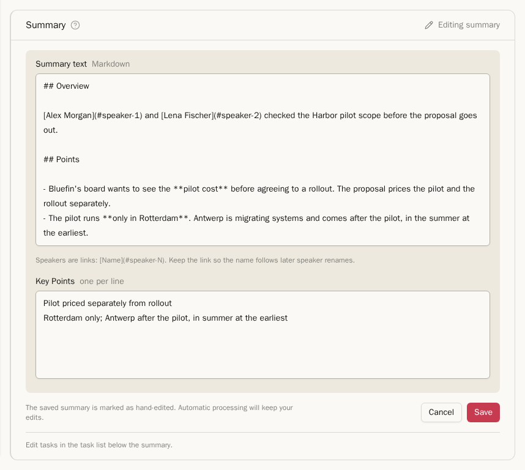
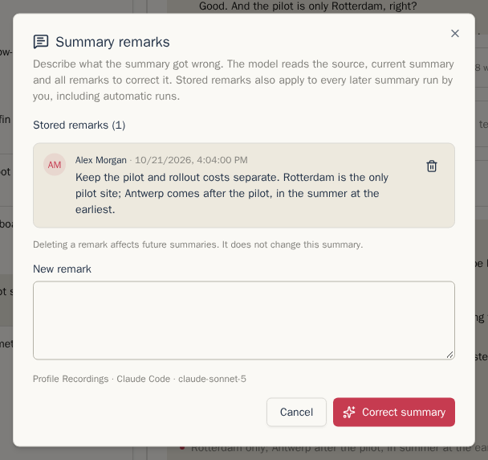
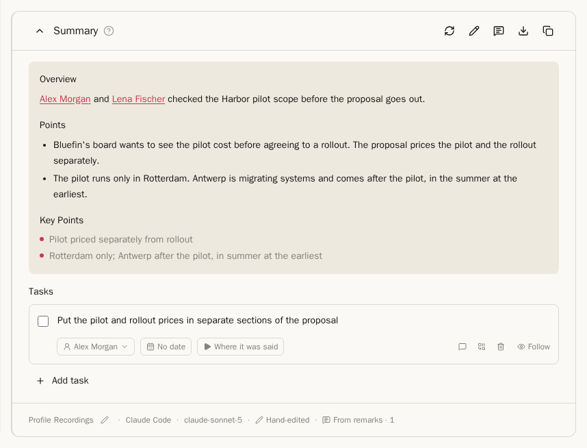
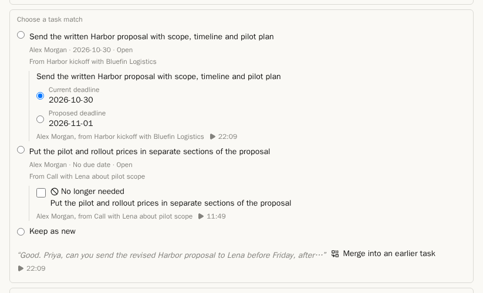
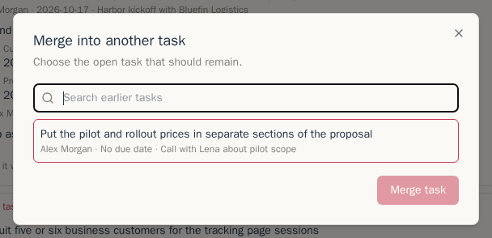
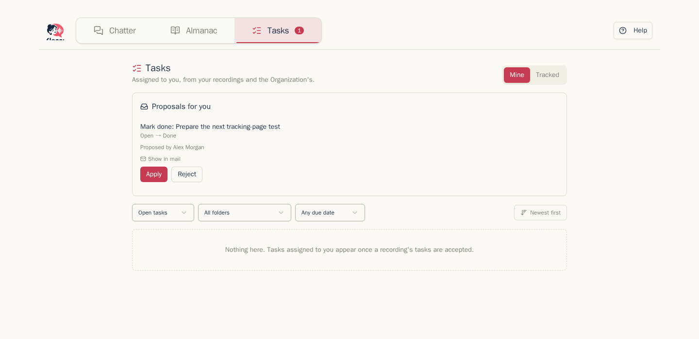

## Summaries

Once a recording has a transcript and the workflow reaches **Summarize**, the **Summary** widget appears below it. Mail has the same widget. During the workflow it is inline; finished earlier widgets fold to one line. When the workflow is done, the transcript and summary remain available; completed Learn results are in the header's **Knowledge** panel.

1. **Profile** followed by its name in the footer below the tasks shows the profile that produced the displayed summary. Its pencil opens the profile list. Choosing a different profile starts a replacement run, with confirmation if the summary was hand-edited; before the first summary, it only selects the next profile. Read-only viewers see no pencil. If the producing profile cannot be resolved, the next run's profile is shown.
2. For the first summary, use **Summarize** in the body or the sparkles icon in the header. The circular arrow **Re-summarize** replaces an existing summary. The chevron left of the title collapses or expands the card. The header also offers **Edit summary** and **Summary remarks** to the owner, followed by download and copy.

The manual picker can use any available profile for that kind of item. Starting a summary yourself keeps the card in place and changes it to its running state. The profile supplies the summary instructions, output language and format, provider, task detection, and multi-pass settings. See [Processing and profiles](processing-and-profiles.md).

While it runs, the card shows how long it has taken and, for a multi-pass summary, how far it is: `Summarizing — 1/3 passes`, then `Merging 3 passes…`. You can leave the page; the summary keeps going and is there when you come back.

Summaries are written in Markdown, so headings, lists and tables show as such. **Key Points** are the last section inside the same summary box. Copied and downloaded Markdown keeps that order: summary text, then key points. The footer below the tasks shows warnings with their actions in an amber band, then one line with the profile, provider, model and markers such as multi-pass or **Hand-edited**.

If you correct names in the transcript after the summary was written, the summary shows **May contain stale names or terms** with a **Regenerate** link. The workflow strip also marks work made from older inputs as **Outdated**.

### Edit a summary

The item's owner can use **Edit summary** (the pencil in the card header) on a generated summary, including on their own recording shared with the Organization, from either view. On someone else's item, curators, other members and recipients do not get these correction controls. The Organization account has no correction controls. Imported **Plaud** summaries cannot be edited or corrected with remarks.

Edit **Summary text** as Markdown and **Key Points**, one per line, then **Save** or **Cancel**. Speaker links show the current names, for example `[Alex Morgan](#speaker-1)`. Keep the `#speaker-N` link so the name follows later speaker renames. Editing the summary does not edit tasks; change those in the task list below it.

Saved text has a **Hand-edited** footer marker; hover over it to see who edited it and when. Automatic processing never overwrites it, including after re-transcription or Learn corrections. It may therefore describe older input. A manual **Re-summarize**, profile change or **Regenerate** asks for confirmation before replacing hand edits. The owner can choose **Write a remark** there instead. Confirming a replacement clears the hand-edited marker.

### Correct a summary with remarks

Open **Summary remarks** (the speech-bubble icon). The dialog lists **Stored remarks** with their author and time, a **Delete remark** button for each, and the profile, provider and model that will run.

Write a **New remark** describing what the summary got wrong and click **Correct summary**. This saves the remark and starts one correction run using the source, current summary and all stored remarks. You can also run it with only the existing remarks. A correction of hand-edited text keeps the **Hand-edited** marker. If the model run fails, the remark stays saved for retrying.

Stored remarks belong to the item and apply to every later summary run by you, including automatic runs and runs after explicit regeneration, in either your private or Organization view. Another actor's manual run, such as a curator's, does not use your remarks. **Delete remark** affects future runs; it does not rewrite the current summary or remove its provenance marker.

The owner sees **From remarks · 1** (with the applied count) in the footer and can click it to reopen the dialog. Readers see the resulting shared text, **Hand-edited** with its author and time when present, and **Corrected from remarks**, without the private remark text or correction controls. Another actor's run clears the remarks marker for that output but keeps the owner's stored remarks for a later owner run.

### Summary instructions and multi-pass

Chatterbox includes summary instructions such as **General Summary**, **Meeting Notes**, **Key Points**, and **Action Items**. They now live inside processing profiles rather than in the summary picker. Edit the profile to change the focus, instructions, output language, or output format.

A profile can run a summary 2 to 5 times and merge the results, so a point only one pass noticed still makes it into the summary. It costs about as many times more as there are passes. The footer says **multi-pass · 3**. When a pass failed and the summary was made from fewer, the marker turns amber, for example **multi-pass · 2/3**; hover over it to see why.

## Tasks across items

### Tasks from a summary

A summary looks for things someone agreed to do. A task no longer belongs to one summary: it collects mentions from recordings and mail filed in its folder scope. **Where it was said** opens the audio passage or highlights the relevant mail text. **Earlier mention** shows older evidence without changing the task.

When task changes are ready, the inline **Task review** widget opens after the summary. The workflow strip says **Review needed** and **Review tasks** jumps to it. If the tasks came from a summary you started yourself after the workflow, a compact **Task review** line offers **Review**; that explicit click opens the review window.

- A new action can show **Suggested matches** to earlier open tasks from the same folder scope. Each card compares the **Earlier task** with what was **Said now**, including both quotes and their evidence times. **Same task: attach this mention** links the new mention without otherwise changing the earlier task. Every suggested match starts unticked, regardless of how many candidates were found or where its evidence came from. Deadline and completion changes also start unticked.
- When several candidates are plausible, choose the right one or **Keep as new**. **Merge into an earlier task** searches all open tasks in the folder scope, not only the suggested candidates.
- A deadline change shows the **Current deadline** and **Proposed deadline**. A completion is marked **Needs confirmation**. An older statement than the task's latest edit appears as **Earlier mention** and needs no decision.
- A summary can also propose **No longer needed** or **Handed to someone else**. These are never preselected. An unknown assignee is shown for checking, not silently created.
- Untick a new task that is not real. Correct its text, assignee, or deadline before accepting it. In the footer, **Add task** adds and focuses a task the summary missed, and **Apply selected changes** applies everything still ticked; **Save and continue later** preserves the review without applying it.

The review shows one card per task. A match is the main decision; deadline, completion, **No longer needed**, and **Handed to someone else** changes for that task appear beneath it. An audio evidence button shows its time and changes to pause while that passage is playing. If the quote cannot be placed in the transcript, the review says so instead of opening an unhelpful link.

After accepting a match, the item's task list lets the item owner undo it, or lets curators do so on a shared item. Undoing separates this mention into its own task. Field changes already applied to the earlier task stay applied.

Accepted tasks are listed on the item. Tick one off when it is done, or use **Add task** to add one by hand. A task lives while at least one mention exists, even if the summary that first found it is replaced.

## Routed proposals

If you review a proposed change but do not have permission to apply it, Chatterbox routes it to someone who does. **Proposals for you** on the Tasks page is the inbox for those decisions, and its navigation badge shows how many wait. Permission is checked again when a proposal is applied.

On a shared task, its home item's owner and Organization curators may edit, change its deadline or assignee, drop it, merge it, and close it. The assignee may also close or reopen it, write its note, and merge it with another task assigned to them. On a private task, only its owner may do those things. These task rights are an exception to the other editing rules for shared items.

When the home item is deleted, the newest surviving mention in the same scope becomes home. If none remains, the task disappears. When a shared home item is withdrawn from the Organization, the newest remaining shared mention becomes home. If none remains, the task becomes private with the withdrawn item. The withdrawn mention is no longer visible to the Organization. Retention that removes audio or generated content does not move the home.

## The Tasks page

**Tasks** in the top bar lists tasks from recordings and mail.

- **Mine**: tasks assigned to you and your own private tasks. Chatterbox knows which person in the Almanac is you by your email address; open your own person in the Almanac and choose **This is me** if your tasks do not show here.
- **Followed**: tasks you explicitly follow, plus tasks from your own items assigned to others or nobody. **Stop following** removes either kind. Curators can switch to **All Organization tasks**; the Organization account continues to see all shared tasks. Old `tab=tracked` links still open this tab.

The filters show open, done or dropped tasks, tasks from one folder, and tasks that are overdue, due this week or have no date. Sort by newest or by due date. Each task offers the actions you have permission to use and **Where it was said** for every mention.

### Own tasks

**Add task** is the first row of **Mine**. Enter up to 2,000 characters and an optional due date. **Only you** means the author is always the assignee and the only person who can see it, including when a curator or the Organization account opens Tasks. You may edit, finish, drop, restore and merge it. It has no recording, cannot be shared or reassigned, raises no badge, and survives item retention and deletion.

The folder pill next to **Only you** optionally files the task in one of your private folders. It defaults to the private folder selected in the Tasks filter, otherwise **No folder**. On the task's source line, click its folder name or **File in a folder** to move it; **No folder** clears it. The unfiled action appears on hover or keyboard focus with a mouse and stays visible on touch. A folder only helps you organize: it never grants anyone access and tasks do not change the library's folder item counts. Recording and mail tasks keep using their source item's folders.

Selecting a private folder in **Mine** includes own tasks filed there or in its subfolders. The **Private** root includes all your own tasks, including unfiled ones, as does **All folders**. An Organization folder hides own tasks. Deleting a folder or moving it outside your private tree clears the task's folder in the same transaction; the task stays private and survives.

Right-click **Tasks** in the navigation, press the context-menu key or Shift+F10 while it is focused, or long press it on touch to open Mine with the form focused. Ctrl-click and middle-click retain normal new-tab behavior. Hold Shift, Ctrl, Alt or Meta while right-clicking to open the browser menu.

### Notes and follows

Ticking a task opens an optional note box. Choose **Skip** or **Save note**. **Note** opens it again at any time. There is one encrypted note of at most 2,000 characters per task; saving replaces it. Everyone who sees the task reads the note with its author and time. Anyone allowed to mark it done may write the note. Notes are searched and backed up; they never enter summary prompts.

**Follow** is available on visible tasks under a recording or mail and on the Tasks page. **Following** remains visible between row actions. A follow survives unsharing: the task is hidden until its item becomes visible again. Followers can open the task detail page. Follows and unfollows belong to the follower's personal backup. Own tasks and changes on followed tasks do not raise the assignment badge.

On the Tasks page the source is a small button under the text. Under a recording or mail, **Where it was said** shares the assignee and due-date row. Actions appear on hover or keyboard focus with a mouse and stay visible on touch.

### Merging tasks

Use **Merge into another task** for duplicate open tasks. Assignees can choose from their other open tasks across recordings, mail and own tasks. The dialog previews the server's result: the kept text followed by the other text on a new line, the notes joined in the same order, and the earlier due date. Both items' links and followers stay, and pending proposals move. A result over 2,000 characters is refused so no text is lost.

An Organization task always remains. Adding a private task to it requires confirming that its text and note become visible to everyone who sees the Organization task. A merge is irreversible. Cross-owner merges notify the kept task's owner through the existing proposal inbox.

### Task backups and restore

Personal backups include `tasks/personal.json`, `tasks/follows.json` and notes in the existing item task files. Organization backups exclude own tasks and members' follow preferences. To import extracted task data after restoring its items and people, an authenticated session may POST to `/api/tasks/restore` with `{personal, items, follows}`: `personal` is the own-task array, `items` contains `{itemId, tasks}` from each recording's `tasks.json` or mail's task array, and `follows` is the preference array. Existing task IDs are kept unchanged; IDs belonging to another owner are refused. Follow references to tasks absent from the installation are skipped. This imports tasks; the app has no general archive restore screen.

Each own task carries `folderId`. After restoring the private folders from `organization/folders.json`, add `folders: [{id, restoredId}]` to the import request to map each archived folder ID to its restored private folder ID. References without a mapping become null, including folders omitted from the archive. Organization and other users' target folders are refused. Organization archives are unchanged.

Next: [The Almanac](almanac.md)
