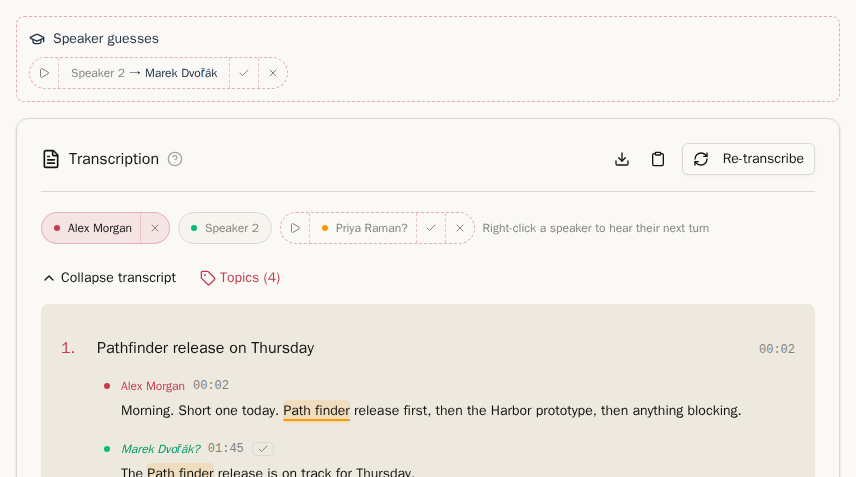
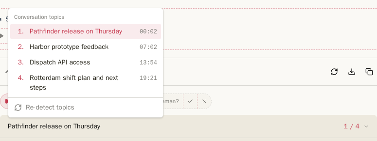
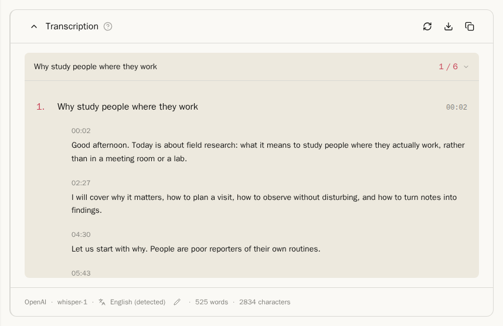
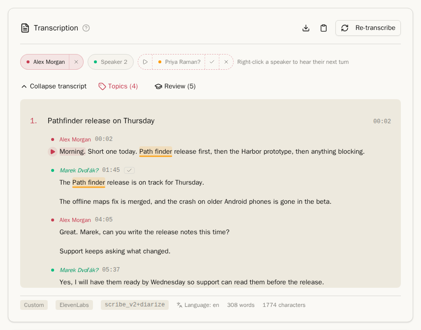
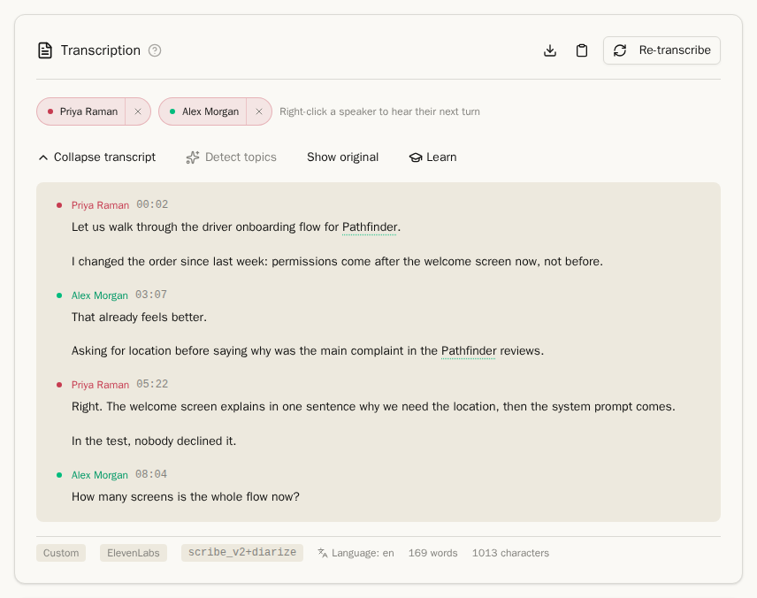
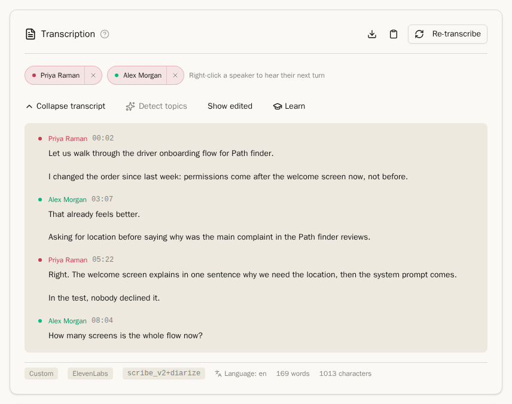

## Získání přepisu

Nahrávka bez přepisu nabízí dvě tlačítka:

- **Přepsat** odešle zvuk k poskytovateli přepisů Vašeho účtu (Nastavení → Přepis). Funguje i tehdy, když nahrávka ještě čeká na zařazení.
- **Přepsat v prohlížeči** spustí Whisper ve vašem prohlížeči. Je to zdarma a nic neopustí váš počítač, ale je to pomalejší.

**Znovu přepsat** u nahrávky, která už má přepis, nejprve požádá o potvrzení a pak spustí přepis s vaším aktuálním poskytovatelem. Jde o placené volání poskytovatele. Nahradí přepis a obnoví vygenerované výsledky podle profilu zpracování. Ručně upravené shrnutí zůstane zachováno a existující název se automaticky nenahradí. Viz [Úpravy shrnutí](summaries-and-tasks.md#edit-a-summary). Jména mluvčích, která jste zadali, jsou předána do nového přepisu jako návrhy, které potvrdíte jedním kliknutím.

Nahrávka se přepíše automaticky až po zařazení a pouze tehdy, když má její [profil zpracování](processing-and-profiles.md) u přepisu zapnuté **Spouštět automaticky**. Profil může zvolit jiného poskytovatele a jazyk než výchozí hodnoty účtu používané tlačítkem **Přepsat**.

### Jakého poskytovatele zvolit

Funguje jakákoli služba, která podporuje OpenAI API, a další tři jsou zabudované. Vaše volba určuje, co získáte:

| Poskytovatel | Rozlišení mluvčích | Časování | Poznámky |
| --- | --- | --- | --- |
| ElevenLabs Scribe (**označení mluvčích**) | Ano | Ano | Rozpoznává jména z vašeho Almanachu. |
| Speechmatics (**označení mluvčích**) | Ano | Ano | Rozpoznává jména z vašeho Almanachu. `melia-1` zvládne více jazyků v jedné nahrávce. |
| OpenAI `gpt-4o-transcribe-diarize` | Ano | Ano | |
| OpenAI `whisper-1`, Groq, místní Whisper | Ne | Ano | Dlouhé projevy se dělí do odstavců. |
| OpenAI `gpt-4o-transcribe`, Google Gemini | Dle případu | Ne | |

**Na časování záleží.** Témata, Učení, přehrávání jedné věty a navigace v přepisu vyžadují informaci o tom, kdy byla která replika řečena. Přepis bez časování se zobrazí jako prostý text.

**Jména z Almanachu.** ElevenLabs Scribe v2 a Speechmatics dostanou s každou nahrávkou až 500 jmen z vašeho [Almanachu](almanac.md): nejprve vaše, pak účastníky schůzky z připojeného Kalendáře a Meet a potom nedávno zmíněné osoby a věci. Jména pak napíšou správně mnohem častěji. Jména jsou odesílána u každé nahrávky, včetně osob, jež se v ní nevyskytují.

**Přepisy z diktafonu.** Pokud služba vašeho diktafonu vytvořila vlastní přepis a shrnutí, Klepna je dokáže importovat (Nastavení → Přepis → **Importovat přepisy a shrnutí Plaud**). Nahrávka, která má oba, zobrazí přepínač mezi **Plaud** a **Vlastní**.

## Čtení přepisu

Přepis s mluvčími se čte jako rozhovor, každý příspěvek je barevně odlišený blok se jménem mluvčího a časem začátku. Šipka vlevo od nadpisu **Přepis** kartu sbalí nebo rozbalí. Vpravo kruhová šipka **Přepsat znovu** požádá o potvrzení, za ní následují ikony stažení a kopírování. Popisek ikony se zobrazí po najetí myší nebo zaměření klávesnicí. V zápatí vidíte poskytovatele, model, jazyk a délku přepisu.

### Jazyk nahrávky

Zápatí ukazuje použitý jazyk, například **čeština (rozpoznaný)**, dokud jej nepotvrdíte, potom jen **čeština**. Tužka vedle jazyka otevře seznam. Výběr uloží změnu; Escape nebo zavření seznamu nic nemění. Jazyk může měnit vlastník nebo kurátor v pohledu Organizace. Ostatní čtenáři vidí jen text. Volba patří nahrávce a zůstane zachována i po novém přepisu. **Automaticky** potvrzení smaže.

Výslovně zvolený jazyk výstupu v profilu nebo nastavení účtu má přednost. Jinak potvrzený jazyk určuje jazyk shrnutí, názvu a témat a poskytuje jazykový kontext Učení, opravám a pravopisu. Bez potvrzení automatický výstup následuje převládající jazyk přepisu.

Změna jazyka sama nic znovu nespouští. Pokud se existující výstup jazykově liší, ovládací prvek nabídne **Znovu shrnout** se stávající akcí shrnutí. Pokud se odhad poskytovatele liší od potvrzeného jazyka, **Znovu přepsat v jazyce …** vyžaduje obvyklé potvrzení nahrazení a nastaví daný jazyk jen pro tento běh. Běžný přepis si ponechá dosavadní volbu jazyka z profilu nebo účtu. Exporty a zálohy uchovávají potvrzený jazyk odděleně od odhadu poskytovatele.

### Pojmenování mluvčích

Štítky nad přepisem představují mluvčí.

- Klikněte na jméno ve štítku, například **Mluvčí 2**, a vyberte, kdo to je, ze svého [Almanachu](almanac.md), vytvořte novou osobu nebo označte mluvčího jako **Neznámý**.
- Přerušovaný štítek končící na **?**, například **Priya Raman?**, je návrh. Klikněte na **✓** pro potvrzení nebo **×** pro odmítnutí; odmítnuté jméno již nebude tomuto mluvčímu nabídnuto. **▶** přehraje okamžik, na jehož základě návrh vznikl. Pokud návrh nemá ukázku, přehraje další promluvu tohoto mluvčího.
- **Hádaní mluvčích** nad přepisem jsou poznatky z Učení. Viz [Učení](learn.md).
- Barevné **▶** má každý štítek, i ten, u kterého jste mluvčího ještě neurčili. Přehraje další promluvu tohoto mluvčího. Pravé tlačítko myši zůstává zkratkou. Kliknutím na potvrzené jméno vyberete jinou osobu nebo zvolíte **Otevřít v Almanachu**, **×** jméno odpojíte. Kliknutí na jméno neznámého mluvčího otevře stejný výběr.

Zadaná jména se zobrazují všude tam, kde vystupuje přepis: ve shrnutí, exportech, zkopírovaném Markdown i v API.

Návrhy mluvčích ukazují původ a u odhadu také vysvětlení modelu v nápovědě. Kalendář a Meet se používají při automatickém i ručním běhu. Návrh s **?** potvrdíte jedním kliknutím; nezaškrtnutý návrh mluvčího nikdy nepojmenuje. Identita vychází z pozvánek, účasti a vodítek v přepisu, nikdy z hlasových dat.

### Témata

**Témata** rozdělí dlouhý přepis do kapitol s názvem. Kliknutím na **Rozpoznat témata** se témata vytvoří; pak klikněte na lištu kapitol připnutou nad textem. Při posouvání i během přehrávání ukazuje pořadí aktuálního tématu, celkový počet a název. Výběrem tématu ze seznamu s čísly, názvy a časy přeskočíte na jeho začátek: přepis se posune na nadpis a přehrávač na jeho začátek. Profil zpracování se zapnutou volbou **Spouštět automaticky** u témat je rozpozná po každém novém přepisu. Pokud je můžete spustit, v seznamu najdete i **Rozpoznat témata znovu**. Lišta zůstane dostupná i ve sbaleném přepisu; výběrem tématu přepis rozbalíte. Dokud Učení čeká na kontrolu, lišta zobrazuje **Témata počkají na kontrolu učení**.

### Dlouhé projevy

Přednáška nebo dlouhý monolog se rozdělí do odstavců zhruba po půl minutě – na konci věty a vždy, když začíná nové téma. Každý odstavec ukazuje čas začátku.

## Přehrávání z přepisu

- **Klikněte na větu** a nahrávka se od ní přehraje. Opětovným kliknutím přehrávání pozastavíte.
- **Klikněte na časový údaj,** čímž přesunete přehrávač na danou pozici bez spuštění přehrávání.
- **Při přehrávání** je právě mluvená věta zvýrazněna a přepis se automaticky posouvá. Pokud přepis posouváte sami, přehrávání se přesune na větu, na které se nacházíte.

## Opravená slova

Pokud Učení opravilo špatně rozpoznané jméno, přepis jej zobrazuje již opravené. Opravená slova mají tečkované podtržení.

| Opraveno | Původní |
| --- | --- |
|  |  |

- Přepínač **Původní znění** na konci lišty kapitol ukáže, co slyšel poskytovatel. Vypnutím se vrátíte k opravenému textu. Zobrazí se jen tehdy, když Učení něco opravilo, i bez témat. V úzké kartě se popisek zkrátí na **Původní** a záhlaví používá ikony. Stažení i kopírování zůstávají přímo dostupné jako ikony v záhlaví.
- Klikněte na opravené slovo a zrušíte tuto jednu opravu.
- Shrnutí, témata, vyhledávání, exporty i API vždy využívají opravený text.

Viz [Učení](learn.md), kde vznikají opravy.

## Kopírování a stahování

Dvě ikony v záhlaví přepisu umožní přepis zkopírovat do schránky nebo stáhnout jako Markdown soubor, se jmény mluvčích a zapracovanými opravami. Shrnutí obsahuje stejné dvě ikony.

Další: [Shrnutí a úkoly](summaries-and-tasks.md)
